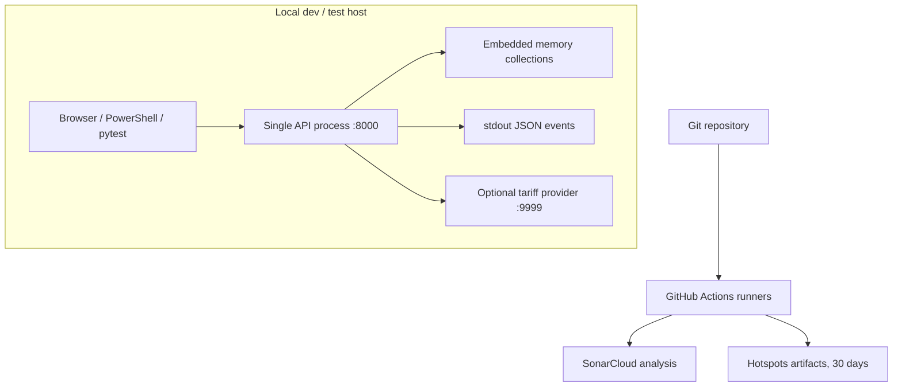

# ISD — Infrastructure Specification Document

Дата: **15.11.2026**. Код baseline: `8545112ad2e693517b45ec15ff6c3c03e7438363`. Власник навчальної поставки: maintainer `Vlad8800`. [SDD](sdd.md), [README](../index.md), [ADR](adr/README.md), [матриця аудиторій](../audience-matrix.md).

## Scope and deployment

**Реалізовано:** локальний Python/FastAPI runtime, in-memory дані, stdout-логи, GitHub Actions. **Документована локальна конфігурація:** ASGI-сервер Uvicorn, один worker, loopback `127.0.0.1:8000`. **Запропоновано:** production-вимоги, моніторингові пороги й цілі відновлення нижче. Немає Dockerfile/Compose/Kubernetes для runtime, інфраструктурного IaC чи автоматичного production deploy. Docker-контейнер у workflow ЛР7 — середовище сканера, не deployed API.



Ця топологія не означає, що зовнішній tariff server включений у проєкт: показана очікувана адреса іншого процесу. За його недоступності працює fallback. [Контракти](sdd.md#tariff).

## Environments

| Середовище | Розміщення, процеси, дані | Конфігурація та статус |
| --- | --- | --- |
| dev | Windows/Linux/macOS; один ASGI worker; seeded memory | Python 3.11 як орієнтир CI, `venv`, host 127.0.0.1, port 8000; команди в README |
| test | `pytest`/TestClient; окремий процес тестового запуску | `pytest.ini`: pythonpath=`.`, testpaths=`tests`; mocks зовнішнього тарифу й reset repository в тестах |
| CI SonarCloud | `ubuntu-latest`, Python 3.11, окремий job | Встановлення requirements + pytest-cov + pytest-mock; pytest/coverage; Sonar scan |
| CI Hotspots | `ubuntu-latest`, container `python:3.11-bookworm` | Git, повна історія, Radon 6.0.1, JSON/CSV artifact |
| production | **Не розгорнуто; специфікація вимог, не існуючий ресурс** | [Production target](#production): перевірений principal, durable data, backups, TLS, observability; допуск після окремої реалізації |

Dev і test не перемикаються через `APP_ENV`: прикладний код не читає цю змінну. `--reload` можна додати лише для розробки; кожний restart відновлює seed і втрачає runtime-зміни. Не використовувати workers>1 для демонстрації узгоджених consent/erasure-операцій: пам’ять не спільна. [ADR-0001](adr/0001-demo-in-memory-boundary.md).

## Shipping policy

[SDD component](sdd.md#shipping-policy). Новий порядок розгортання: checkout → залежності → provision JSON → API.

```powershell
New-Item -ItemType Directory -Force -Path runtime | Out-Null
Copy-Item config/shipping-policy.example.json runtime/shipping-policy.json
.\venv\Scripts\python.exe -m uvicorn app.main:app --host 127.0.0.1 --port 8000 --workers 1
```

`SHIPPING_POLICY_FILE` — необов’язковий env override абсолютного/відносного шляху, default `runtime/shipping-policy.json` від робочого каталогу. Схема: schema_version=1.0, непорожній policy_version. Шаблон committed у config/, runtime/ ігнорується Git. Секретів у файлі немає. Loader читає його до FastAPI startup; файл повинен бути доступний на читання service account. Після зміни restart потрібний. GET /api/v1/shipping/policy показує застосовану версію.

Це залежність від файла, не новий мережевий сервіс. Runtime user data залишаються in-memory. Для recovery/rollback спочатку відновити сумісний descriptor з шаблона відповідного release SHA, потім API; кодовий bundle не включає ігнорований runtime-файл. Секрети через цей механізм не передаються.

## Configuration

| Параметр | Де задається | Значення / значення за замовчуванням | Секрет? / статус |
| --- | --- | --- | --- |
| ASGI app | CLI | `app.main:app` | Ні, документовано |
| Host/port/workers | Uvicorn CLI | `127.0.0.1`, `8000`, `1` | Ні; не app env |
| `SHIPPING_POLICY_FILE` | env | runtime/shipping-policy.json, якщо не задано | Ні; чинний path override, файл обов’язковий |
| `PYTHONPATH` | Sonar job env / pytest config | `.` | Ні; реально застосовується |
| `EXTERNAL_TARIFF_API_URL` | `app/services.py` | `http://127.0.0.1:9999/api/v1/tariffs` | Ні; константа коду, **не env override** |
| `FALLBACK_SHIPPING_RATE` | `app/services.py` | `25.0` | Ні; константа коду |
| HTTP timeout/retry | `app/services.py` | 0.5; максимум 3 спроби; backoff 0.1–0.5 | Ні; константи/декоратор |
| Log level/JSON | `setup_privacy_logging()` | INFO / `json_format=True` | Аргументи функції, не LOG_LEVEL env |
| `LAB6_PYTHON` | `scripts/pre-commit` | Шлях до Python; інакше `.venv-1/Scripts/python.exe` або `python` | Ні; лише локальний CC hook |
| `SONAR_TOKEN` | GitHub Actions secrets | Значення в документі відсутнє | Так; не додавати в `.env`/репозиторій |
| `GITHUB_TOKEN` | Actions-generated token | Значення в документі відсутнє | Так; CI context, не runtime-залежність API |
| `DATABASE_URL`, `APP_ENV`, `PAYMENT_GATEWAY_TOKEN` | Історичний `.env.example` | Приклад/placeholder | Прикладний код не читає; `.env` сам по собі не завантажується |

`.env.example` — історичний шаблон, не чинна специфікація БД. Наявність `sqlite:///...` у ньому не створює SQLite storage. Цим завданням встановлено правдивий контракт конфігурації в README/ISD; вихідний шаблон і runtime-код не переписувалися. Зміна адреси tariff provider зараз потребує явної зміни константи коду; env-параметризація — окрема майбутня зміна.

## SDD component deployment map

### API

[Компонент SDD](sdd.md#api). Один процес `uvicorn app.main:app`, без окремого frontend. `/` — HTML; `/docs`, `/redoc`, `/openapi.json` — FastAPI. Порт 8000 у quick start; перевірка доступності через `/openapi.json` і бізнес-запит UA. `/health` чи deep readiness endpoint у baseline відсутні. Запуск і smoke-команди — [README](../index.md#quick-start-для-windows-powershell).

### Orders

[Компонент SDD](sdd.md#orders). Імпортується тим самим API-процесом, власного порту немає. Перед запуском API потрібен [shipping policy descriptor](#shipping-policy); ціни й retry-конфігурація від нього не залежать. Залежності FastAPI/Pydantic → httpx/Tenacity. UA не потребує мережевого tariff provider; міжнародний шлях може повернути fallback. Value Objects — оперативні об’єкти запиту/відповіді, не database records.

### Export

[Компонент SDD](sdd.md#export). Router і service в тому самому API, доступ до [Repository](#repository). Зовнішніх файлових bucket чи окремого export-worker немає; відповідь будується в запиті. Навчальні actor headers не замінюють довірену production-автентифікацію.

### Anonymization

[Компонент SDD](sdd.md#anonymization). Працює в одному API, послідовно мутує repository. Перезапуск відновлює оригінальні seed-fixtures, зокрема попередньо змінені profiles/consents. Тому restart не є допустимим збереженням erasure-стану реальних користувачів; це межа навчального сховища. Немає background queue, транзакції чи зовнішнього erasure orchestration.

### Consent

[Компонент SDD](sdd.md#consent). Service/gate/singleton — у тому самому API-процесі. Між процесами немає синхронізації. Gate безпосередньо читає repository; Redis чи розподіленої інвалідації немає. Marketing endpoint симулює відправлення, SMTP/API ключ не потрібний.

### Repository

[Компонент SDD](sdd.md#repository). Колекції RAM створюються конструктором `UserDataRepository`. Зовнішніх storage host/port/credentials немає. Стан користувачів, consent history й erasure не пишеться на диск. Application data backup/restore не реалізований. [Recovery objectives](#recovery-objectives), [ADR-0001](adr/0001-demo-in-memory-boundary.md).

### Privacy

[Компонент SDD](sdd.md#privacy). `StreamHandler(sys.stdout)` + JSON formatter/filter; correlation ID через ContextVar. Не налаштовано collector, ротацію, retention чи durable log storage. Operator може захоплювати stdout у логфайл для локального розбору, але це не резервна копія application state. SLO/alerts нижче — специфікація майбутнього збору, не активні правила.

### Tariff

[Компонент SDD](sdd.md#tariff). Очікується інший HTTP-процес на 127.0.0.1:9999. У Docker loopback означає той самий контейнер: перенесення API в контейнер без нової адресації provider не підтримує описану інтеграцію. Власної реалізації/образу цього сервісу немає. Доступність зовнішнього provider визначається його власником; fallback зберігає відповідь API, але змінює економічне припущення про тариф.

### Tooling

[Компонент SDD](sdd.md#tooling). Джерела: [Sonar workflow](https://github.com/Vlad8800/QA_1lab/blob/lab11-documentation-as-code/.github/workflows/sonarcloud.yml), [Hotspots workflow](https://github.com/Vlad8800/QA_1lab/blob/lab11-documentation-as-code/.github/workflows/lab7-hotspots.yml), [quality_gate.py](https://github.com/Vlad8800/QA_1lab/blob/main/quality_gate.py), [hook](https://github.com/Vlad8800/QA_1lab/blob/lab11-documentation-as-code/scripts/pre-commit), [Gitleaks config](https://github.com/Vlad8800/QA_1lab/blob/main/.pre-commit-config.yaml), [k6](https://github.com/Vlad8800/QA_1lab/blob/main/load_test.js).

| Контур | Тригер / середовище | Стадії | Gate та реальна межа |
| --- | --- | --- | --- |
| SonarCloud | push лише `main`; PR opened/synchronize/reopened; ubuntu-latest/Python 3.11 | checkout full history → pip requirements + pytest-cov/pytest-mock → provision shipping-policy JSON → pytest coverage.xml → Sonar scan | pytest nonzero блокує job; окремого `sonar.qualitygate.wait=true` чи Quality Gate action немає; статус Sonar server/branch protection не підтверджений конфігом |
| Hotspots ЛР7 | кожний push і pull_request; Python 3.11 Docker job | apt Git → checkout fetch-depth=0 → safe.directory → Radon 6.0.1 → build_hotspots → upload artifact | `max CC>10`, churn>=5 — класифікація, **не блокування job за категорією**; помилка скрипта/відсутність artifact — відмова; `if: always()` на upload |
| CC hook ЛР6 | локальний git commit після ручного встановлення | staged `.py` з індексу → Radon кожного методу | `CC>10` або scan error → exit 1; це не CI gate й не перевірка всього дерева |
| Gitleaks | `.pre-commit-config.yaml`, rev v8.21.2 | `gitleaks protect --staged --verbose --redact` | Конфіг присутній; standalone binary і hook framework самі ним не встановлюються |
| k6 ЛР2 | ручний `k6 run load_test.js` при запущеному API | 5s ramp-up, 20s hold, 5s ramp-down; до 15 VUs | `p(95)<200 ms`, `http_req_failed<0.01`; ці thresholds задані скриптом, не CI. Для correctness checks окремого threshold немає |

Hotspots artifact зветься `lab7-hotspots-${github.run_id}`, містить п’ять JSON/CSV/TXT файлів, `retention-days: 30`. Coverage.xml у job створюється, але його окремого upload-artifact немає. Немає build/deploy/release/rollback стадії. Правила з історичних ЛР3–5 не називаються CI gates, якщо в workflow їх немає.

Quick start встановлює явно відсутні пакети server/test. Історичні `scripts/demo_lab6_hook.ps1` і `scripts/demo_lab6_history.ps1` перевіряють `.venv-1/Scripts/python.exe`: для них потрібне окреме середовище з Radon (`py -3.11 -m venv .venv-1`, потім встановлення Radon). Hook demo створює гілку/коміт, тому його запускають на чистій спеціальній копії; для простого читання паспорта це не потрібно. Пряме копіювання `scripts/pre-commit` у `.git/hooks/pre-commit` і `pre-commit install` можуть перезаписувати один одного: перевірити кінцевий hook перед використанням, а не припускати роботу обох контурів.

## Monitoring

| Сигнал | Наявне джерело | Ціль / дія оператора | Статус |
| --- | --- | --- | --- |
| HTTP status/duration/correlation | JSON події middleware | Дослідити 5xx за correlation ID; availability target для production визначається окремо | Логи є; dashboard/alert не встановлено |
| p95 та частка failed requests | Ручний k6 `load_test.js` | p95<200 ms, failure rate<1% для зазначеного local UA workload | Скрипт реалізує thresholds; новий load-run у цій поставці не заявляється |
| Tariff fallback | `Fallback activated`, shipping.is_fallback | Proposed alert: >5% міжнародних розрахунків за 5 хвилин → перевірити provider; це не поріг з поточного коду | Опис майбутнього collector; counters/alert відсутні |
| Consent DENY/export denied | event_type у privacy logs | Розібрати очікувану відмову/можливу помилку principal, не зберігати raw bodies | Події реалізовані; автоматичне сповіщення не налаштоване |
| Source complexity/churn | Hotspots artifact | maxCC>10/churn>=5 для пріоритету аналізу | Scanner є; thresholds не production availability SLO |

Інтервали, що позначені Proposed, — проектні цілі. JSON-логи не дорівнюють встановленому Prometheus/Grafana чи стійкому audit trail. Перевірка доступності `/openapi.json` засвідчує роботу API, а не доступність external tariff чи durable storage.

## Recovery objectives

RTO — допустимий час повернення працездатного сервісу після відмови. RPO — допустимий часовий обсяг втрачених змін даних. Значення нижче — **цілі**, не результати виміряного SLA.

| Об’єкт | Ціль RTO | Ціль RPO | Поточна досяжність / обмеження |
| --- | --- | --- | --- |
| Dev/test: відновити код і seed-demo | <=15 хвилин за наявності Python, залежностей і перевіреного Git bundle | 0 щодо відомого зафіксованого seed/SHA | Bundle відновлює committed код, не RAM. Мета RPO=0 стосується лише відомого seed, а не користувацьких мутацій |
| Поточні runtime consents/erasure/profile changes | Числовий RTO повного відновлення стану не забезпечений | Обмежений RPO не забезпечений: можливі втрати всіх змін від створення процесу | Реальної резервної копії mutable RAM немає; restart повертає seed |
| Production target після реалізації persistence | <=60 хвилин | <=15 хвилин | Proposed; durable БД, журнал змін/backup, зовнішня копія та restore drill ще не реалізовані |
| Локальні stdout-логи | Не гарантований | Не гарантований | Захоплення/ротація/backup collector у baseline не налаштовані |

### Backup and restore runbook

Для поточного навчального baseline резервується **код і committed fixtures**, а не runtime-дані. Приклад PowerShell з кореня repo:

```powershell
New-Item -ItemType Directory -Force -Path .\artifacts\backup | Out-Null
git bundle create .\artifacts\backup\qa1lab-code.bundle --all
git bundle verify .\artifacts\backup\qa1lab-code.bundle
Get-FileHash .\artifacts\backup\qa1lab-code.bundle -Algorithm SHA256
```

Оператор зберігає bundle й checksum поза єдиним диском робочої копії у своєму сховищі резервів; автоматичного такого копіювання в проєкті немає. Відновлення робити в **новий** каталог, не поверх незбережених файлів:

```powershell
git clone .\artifacts\backup\qa1lab-code.bundle .\qa1lab-restored
git -C .\qa1lab-restored rev-parse HEAD
git -C .\qa1lab-restored status --short
```

Далі виконати quick start у відновленому каталозі, smoke UA=52, тести та зафіксувати elapsed time. Порівняти HEAD із записаним release SHA й SHA256 bundle. Після restart зміни consent/erasure не відновлюються — seed є новою демонстраційною сесією. Для production target план: encrypted backup + транзакційний журнал поза хостом; інтервал recovery points <=15 хв; щомісячний restore drill із перевіркою даних та фактичних RTO/RPO; власник — майбутній DevOps/operator. Це специфікація, а не існуючий cron job.

## Release and rollback

Віддаленого автоматичного deploy немає. Локальний навчальний реліз: перевірити чисту копію й tests → записати release SHA → зупинити власний API (`Ctrl+C`) → у виділеному deployment checkout перейти на цей SHA → запустити один worker → smoke/read-only перевірки. Для rollback аналогічно запустити попередньо записаний SHA в окремій чистій копії. Приклад повернення на відомий baseline:

```powershell
git status --short
git switch --detach 8545112ad2e693517b45ec15ff6c3c03e7438363
.\venv\Scripts\python.exe -m uvicorn app.main:app --host 127.0.0.1 --port 8000 --workers 1
```

Цей SHA передує паспорту; документація для поточного релізу міститься у доставленій гілці. Не виконувати switch у брудному робочому каталозі та не застосовувати reset/clean для «лікування» чужих змін. Код rollback не повертає попередні RAM-дані; для production потрібна окрема сумісність схеми та restore-процедура. Release SHA й результат smoke — частина журналу оператора.

## Production

Специфікація production на дату паспорта: один захищений API entrypoint за TLS proxy; довірений identity provider; durable транзакційне сховище для профілів/consents/erasure; правила multi-worker state; зовнішній log collector; контроль доступу до секретів; backup/restore drill з цілями вище. Конкретного cloud account, domain, VM size чи секретного URL не вигадуємо — вони не задані й не provisioned.

Зберігати поточне in-memory сховище і клієнтські actor headers для реальних production-даних не є прийнятим рішенням. Документ закриває питання «що працює зараз і що потрібно для production», а не позначає майбутні механізми реалізованими. [ADR-0001](adr/0001-demo-in-memory-boundary.md), [межі SDD](sdd.md#security-boundaries).

## Verification

Перевірки цієї документаційної поставки: відповідність HTTP-route переліку коду; локальні файлові посилання та fragment anchors; наявність SDD↔ISD зв’язку для кожного компонента; потрібні поля ADR; запуск наявних тестів і smoke за наявності сумісного Python. [Звіт і фактичні обмеження перевірки](https://github.com/Vlad8800/QA_1lab/blob/lab11-documentation-as-code/docs/lab10/task2-report.md). Production restore SLA, новий запуск GitHub CI та load test не заявляються виконаними без відповідних логів.

## Пов’язані знання

[[architecture/sdd|SDD]] · [[architecture/isd|ISD]] · [[architecture/adr/0001-demo-in-memory-boundary|ADR-0001]] · [[architecture/adr/0002-immutable-shipping-contracts|ADR-0002]] · [[developer/local|Локальний запуск]]

## Documentation as Code — ЛР11

| Етап | Залежність | Quality Gate |
| --- | --- | --- |
| Checkout | Push / PR | Повна історія Git |
| Python + Node | Checkout | Встановлені залежності |
| Spectral | Install | Нуль помилок і попереджень контракту |
| markdownlint | Install | Коректний Markdown |
| Front matter | Install | Власник, статус, непрострочена review_date |
| Contract tests | Запущений локальний API | Три маршрути, валідні та хибні запити |
| MkDocs strict | Попередні перевірки | Нуль warnings, інакше Exit Code 1 |
| Pages | Успішний docs-build у main | OIDC, environment github-pages |

Workflow: .github/workflows/docs.yml. PR та навчальна гілка лише перевіряються; deploy виконується з main.
Змінна DOCS_CORS_ORIGINS дозволяє звернення Swagger до локального API з <http://127.0.0.1:8001>.
MkDocs працює окремим процесом на порту 8001; це інструмент документації, а не сервіс бізнес-системи.


## Експлуатація — ЛР12

Розгортання: `python -m uvicorn app.main:app --host 127.0.0.1 --port 8012`;
health probe: GET `/api/v1/shipping/policy`, очікується 200 та затверджена версія.
Конкретні команди, відкат і ескалація: [RB-001](../runbooks/RB-001.md).
Оновлення: перевірити [CHANGELOG](../../CHANGELOG.md), тести й go/no-go,
підготувати новий артефакт, зупинити власний процес, замінити версію й перевірити.
Схема даних цього релізу не змінюється; SQL-міграції N/A, бо БД відсутня.
Для persistent deployment спочатку restore БД та міграції з backup, потім API.
У поточному demo спочатку policy, потім in-memory repository, API, health/export probes.
[RTO/RPO, 3-2-1 і restore drill](../operations/backup-policy.md),
[SLO та error budget](../operations/service-levels.md),
[release checklist](../changes/release-checklist.md).
