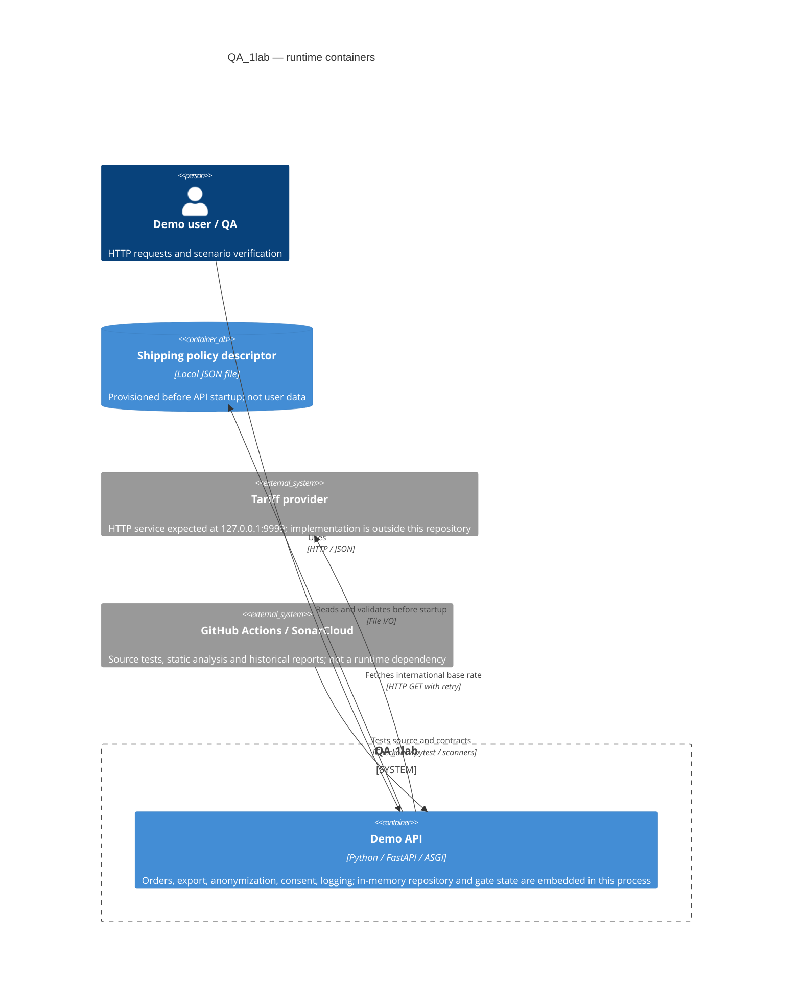
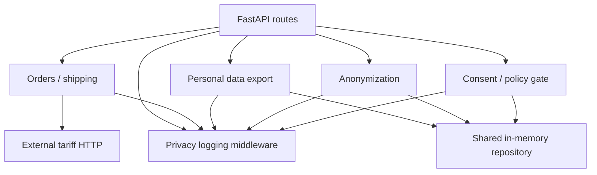
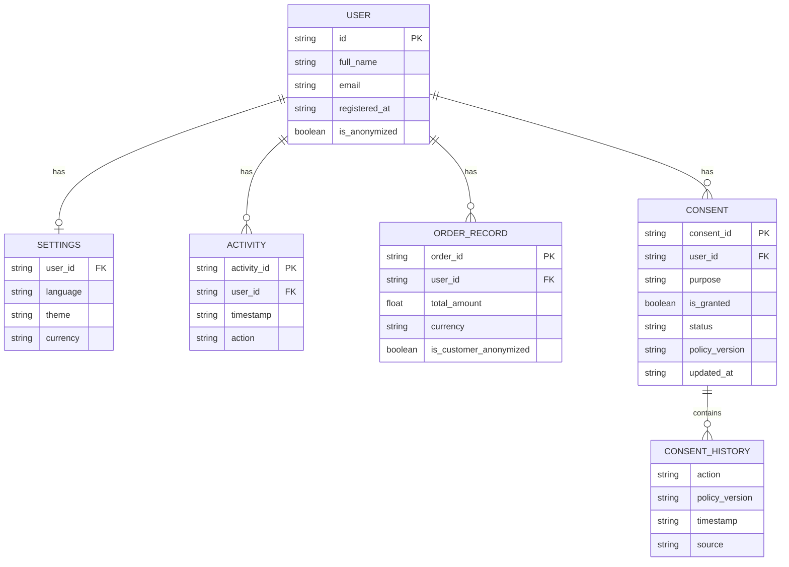

# SDD — System Design Document

Дата паспорта: **15.11.2026**. Власник навчальної поставки: maintainer `Vlad8800`. Описаний код: `8545112ad2e693517b45ec15ff6c3c03e7438363`; документи додаються окремим комітом. Навігація: [README](../index.md), [ISD](isd.md), [ADR](adr/README.md), [аудиторії](../audience-matrix.md).

## Purpose

Система навчає перевіряти якість сервісу замовлень: калькуляцію, Retry/Backoff/Fallback, мінімізацію експорту даних, анонімізацію, керування згодою та контроль метрик. Її користувачі — студент/розробник, QA, викладач і умовний користувач демонстраційних даних. Бізнес-сценарії: отримати вартість замовлення, доступ до своїх даних, змінити згоду на необов’язкову обробку.

Поточна реалізація — **модульний моноліт FastAPI**. Експорт/анонімізація/згоди — Python-модулі в тому самому процесі, без внутрішніх HTTP-викликів. Маркетингове «відправлення» лише моделюється результатом і логом, зовнішнього SMTP-провайдера немає. Сховище не є SQLite/PostgreSQL: це Python-колекції. Розрахунок замовлення не додає запису до `_orders`; там заздалегідь задані дані для демонстрації експорту.

Назви GDPR у вихідному коді описують навчальні сценарії, а не сертифікацію чи правовий висновок. Описуємо реалізовані дії з полями, не переносимо в паспорт неперевірені юридичні гарантії зі старих коментарів. [Межі безпеки](#security-boundaries), [production](isd.md#production).

## C4 container view



У C4 вище сховище навмисно включено в опис контейнера API: у пам’яті процесу воно не утворює окремого контейнера/сервера. Усі його колекції показані в [моделі даних](#data-model). Другого runtime-застосунку, брокера, зовнішньої БД чи окремого frontend-контейнера в репозиторії немає. Сторінка `/` і Swagger віддаються тим самим API. C4-синтаксис звірено з [офіційною документацією Mermaid](https://mermaid.js.org/syntax/c4.html).

## Component map



### API

Відповідальність: [app/main.py](https://github.com/Vlad8800/QA_1lab/blob/lab11-documentation-as-code/app/main.py) створює FastAPI, підключає маршрутизатори й middleware, визначає `OrderRequest`/`OrderItem` та HTTP-адаптер розрахунку. Залежності: [Orders](#orders), [Export](#export), [Anonymization](#anonymization), [Consent](#consent), [Privacy](#privacy). Нормалізація товару — [app/utils.py](https://github.com/Vlad8800/QA_1lab/blob/lab11-documentation-as-code/app/utils.py). API не є сховищем чи окремим сервісом авторизації. [Розгортання в ISD](isd.md#api).

### Orders

Відповідальність: [app/services.py](https://github.com/Vlad8800/QA_1lab/blob/lab11-documentation-as-code/app/services.py) обчислює subtotal, знижку й доставку. `ShippingOrderSpec` та `ShippingRateResult` — `@dataclass(frozen=True)`. Специфікація нормалізує країну/рівень клієнта, відхиляє `weight<=0`, інкапсулює таблиці надбавок. `calculate_shipping_cost(spec)` оркеструє [Tariff](#tariff), а формула `spec.calculate_cost(base_rate)` обчислює вартість. Інтеграційний виклик не називаємо чистою функцією: він може виконувати I/O і логувати. Взаємодіє з [API](#api) та [Privacy](#privacy), не записує замовлення в [Repository](#repository). [ADR-0002](adr/0002-immutable-shipping-contracts.md), [ISD](isd.md#orders).

### Export

Відповідальність: [routes](https://github.com/Vlad8800/QA_1lab/blob/lab11-documentation-as-code/app/export/routes.py) → [PersonalDataExportService](https://github.com/Vlad8800/QA_1lab/blob/lab11-documentation-as-code/app/export/service.py) → [Repository](#repository). `PersonalDataExportResponse` збирає profile/settings/activity/orders/consents і `documented_omissions`. Pydantic DTO відбирають дозволені поля; hashes/tokens/risk flags не входять до експорту. `_resolve_authenticated_principal` використовується також [Anonymization](#anonymization) і [Consent](#consent). Події передаються в [Privacy](#privacy). [Схеми](https://github.com/Vlad8800/QA_1lab/blob/lab11-documentation-as-code/app/export/schemas.py), [ISD](isd.md#export).

### Anonymization

Відповідальність: [routes](https://github.com/Vlad8800/QA_1lab/blob/lab11-documentation-as-code/app/anonymization/routes.py) → [AnonymizationWorkflowService](https://github.com/Vlad8800/QA_1lab/blob/lab11-documentation-as-code/app/anonymization/service.py). Використовує [політики](https://github.com/Vlad8800/QA_1lab/blob/lab11-documentation-as-code/app/anonymization/policy.py), [Repository](#repository), resolver із [Export](#export) та [Privacy](#privacy). Змінює name/email на замінники; очищає phone/address/credentials; видаляє settings/activity; зберігає orders з прапорцем; відкликає consents. Повторний виклик повертає `ALREADY_ANONYMIZED`.

Це послідовні мутації колекцій, **без DB-транзакції та rollback**. Технічний user ID і зв’язки залишаються: це не доказ математичної незворотності ідентифікації. Тіло `AnonymizationRequest` приймається схемою, але `reason`/`confirm_irreversible` не керують дією endpoint. `verify_erasure` перевіряє поточні колекції; для суб’єкта без orders значення `orders_retained=false` не означає порушення збереження неіснуючих записів. [ISD](isd.md#anonymization).

### Consent

Відповідальність: [routes](https://github.com/Vlad8800/QA_1lab/blob/lab11-documentation-as-code/app/consent/routes.py) → [ConsentManagementService](https://github.com/Vlad8800/QA_1lab/blob/lab11-documentation-as-code/app/consent/service.py) → [Repository](#repository); [ConsentPolicyGate](https://github.com/Vlad8800/QA_1lab/blob/lab11-documentation-as-code/app/consent/gate.py) керує модельованою marketing-операцією. Grant/revoke оновлюють версію політики, timestamps і history; повтор тієї самої операції не дублює історію. Перевірка доступу виконується для конкретної purpose і, якщо передано, `required_policy_version`.

Gate має `_cache` і `invalidate_cache`, але `evaluate_access` читає repository безпосередньо; це не Redis і не зовнішня кеш-система. [Anonymization](#anonymization) змінює ті самі consents; gate бачить новий стан наступним читанням. Відсутня/відкликана згода → `DENY`. Вартість замовлень не блокується відсутністю маркетингової згоди. Взаємодії: [Export resolver](#export), [Privacy](#privacy), [Orders](#orders). [ISD](isd.md#consent).

### Repository

Відповідальність: [UserDataRepository](https://github.com/Vlad8800/QA_1lab/blob/lab11-documentation-as-code/app/export/repository.py) зберігає `_users`, `_settings`, `_activity`, `_orders`, `_consents`. `get_default_repository()` дає спільний singleton для [Export](#export), [Anonymization](#anonymization), [Consent](#consent); `reset_default_repository()` створює seed-стан для тестів. Залежностей від SQL/ORM немає. Немає WAL, файлової персистентності, унікальних DB constraints чи блокувань між worker-процесами. Кожний worker отримає власні колекції. [ADR-0001](adr/0001-demo-in-memory-boundary.md), [ISD](isd.md#repository).

### Privacy

Відповідальність: [logging setup](https://github.com/Vlad8800/QA_1lab/blob/lab11-documentation-as-code/app/privacy/logger.py), [middleware](https://github.com/Vlad8800/QA_1lab/blob/lab11-documentation-as-code/app/privacy/middleware.py), [context](https://github.com/Vlad8800/QA_1lab/blob/lab11-documentation-as-code/app/privacy/context.py), [filter](https://github.com/Vlad8800/QA_1lab/blob/lab11-documentation-as-code/app/privacy/filter.py), [formatter](https://github.com/Vlad8800/QA_1lab/blob/lab11-documentation-as-code/app/privacy/formatter.py), [sanitizer](https://github.com/Vlad8800/QA_1lab/blob/lab11-documentation-as-code/app/privacy/sanitizer.py), [logging policy](https://github.com/Vlad8800/QA_1lab/blob/lab11-documentation-as-code/app/privacy/logging_policy.py). Middleware додає/генерує `X-Correlation-ID`, реєструє path/method/status/duration та пише відповідний заголовок у відповідь. Filter/formatter маскують чутливі поля й текст. За замовчуванням sink — stdout, формат JSON, рівень INFO.

Усі бізнес-компоненти передають сюди події; [API](#api) підключає middleware. Маскування — перевірювана тестами поведінка, а не гарантія очищення будь-якого довільного формату даних. Власного архіву логів чи Prometheus exporter немає. [ISD](isd.md#privacy).

### Tariff

Зовнішня залежність [Orders](#orders): `GET http://127.0.0.1:9999/api/v1/tariffs?country=PL`, відповідь `{"base_rate":20.0}`. `httpx.Client(timeout=0.5)`; Tenacity — максимум 3 спроби на `RequestError`/`HTTPStatusError`, exponential wait з `multiplier=0.1`, min 0.1, max 0.5. `timeout=0.5` — параметр HTTP-клієнта, не загальний deadline операції. За фінального збою `_fetch_shipping_base_rate` повертає `25.0`, `is_fallback=true`; `UA` отримує локальні `2.0`, без HTTP. Це Retry/Backoff/Fallback, не Circuit Breaker. Поле `attempts` береться зі statistics Tenacity з default, тому його не використовуємо як незалежний точний лічильник усіх мережевих спроб. [ISD](isd.md#tariff).

### Shipping policy

[app/shipping_policy.py](https://github.com/Vlad8800/QA_1lab/blob/lab11-documentation-as-code/app/shipping_policy.py) читає deployment-дескриптор до створення FastAPI в [API](#api). `load_shipping_policy()` читає шлях з `SHIPPING_POLICY_FILE` або `runtime/shipping-policy.json`. Вимагає JSON object, schema_version=1.0 і непорожню строку policy_version, повертає лише ці два публічні поля. API віддає копію descriptor через GET. Немає нового сервера/БД: C4 показує локальний файл як сховище конфігурації, loader працює в API-процесі. Це не [Orders](#orders) tariff engine і не сховище [Repository](#repository). Зміна файла застосовується після restart; неправильний/missing файл → RuntimeError до запуску API. [ISD](isd.md#shipping-policy).

### Tooling

Два GitHub workflows, локальний CC hook, Gitleaks-конфігурація, pytest, k6, сканери Radon і Git churn утворюють контур перевірки; не обслуговують runtime-запити. Взаємодіють з [API](#api)/[Orders](#orders) через тести й аналіз коду. Конкретні стадії, пороги та межі — [ISD](isd.md#tooling). [Історичні докази ЛР6](https://github.com/Vlad8800/QA_1lab/blob/lab11-documentation-as-code/docs/lab6/Звіт%20лабораторна%206.md), [ЛР7](https://github.com/Vlad8800/QA_1lab/blob/lab11-documentation-as-code/docs/lab7/Завдання%203%20Hotspots.md).

## Data model

Логічна ER-схема описує зв’язки Python-колекцій, а не фізичну SQL-схему; FK/унікальність забезпечуються кодом і тестами, не DB engine.



| Колекція/об’єкт | Ключ та зміст | Життєвий цикл |
| --- | --- | --- |
| `_users` | dict за user ID; profile, credentials і internal risk fields | Seed при створенні repo; профіль анонімізується, ID зберігається |
| `_settings` | dict за user ID; UI/notification preferences | Видаляється при erasure |
| `_activity` | list; activity ID/user ID/timestamp/action/resource/status | Seed-історія; видаляється при erasure; не тотожна stdout-логам |
| `_orders` | list; order ID/user ID/amount/currency/status/items_count | Seed; зберігається при erasure, додається flag |
| `_consents` | list; consent ID/user ID/purpose/version/status/timestamps/history | Grant/revoke; логічна пара `(user_id,purpose)`, без DB unique constraint |
| `history` | Вкладений list у consent; action/version/time/source | Це вкладення, а не окрема таблиця; erasure ставить `revoked_at`, не переписує всю history |
| `ShippingOrderSpec` | country_code, weight, is_express, customer_tier, is_holiday | Незмінний DTO одного виклику; не зберігається |
| `ShippingRateResult` | final_cost, is_fallback, attempts, mode | Незмінний результат; `to_dict`, `get`, `__getitem__` для сумісності |

`is_anonymized`/`is_customer_anonymized` можуть бути відсутні в початковому seed і з’являються після операції. Фінансові значення — Python float з округленням, а не decimal money type. Дані seed — локальні демонстраційні fixtures; у документі не дублюються адреси/телефони.

## HTTP contracts

HTTP/JSON поверх одного FastAPI application. Точні Pydantic-схеми доступні з `/openapi.json`; таблиця нижче додає бізнес-результати й помилки, які не всі явно оголошені в OpenAPI. `422` — автоматична перевірка моделі/enum/числових обмежень; `500` можливий для необроблених помилок.

| Метод і шлях | Вхід / заголовки | Успішний результат | Контрольовані помилки / нюанси |
| --- | --- | --- | --- |
| `GET /api/v1/shipping/policy` | Немає | `200`: schema_version, policy_version | Файл перевіряється до startup; відсутній/невалідний файл блокує запуск, а не повертає HTTP 404 |
| `GET /` | Немає | `200 text/html`, навчальна сторінка | Не є deep readiness-перевіркою |
| `POST /api/v1/orders/calculate` | `OrderRequest` | `200`: status/subtotal/discounted_price/shipping/final_total | `422` на price<=0, quantity<=0, weight<=0; `400` при відхиленні item helper; тарифний збій → `200` з fallback |
| `GET /api/users/{id}/personal-data` | Actor headers або demo Bearer | `200 PersonalDataExportResponse` | `401` без principal, `403` чужий ID, `404` суб’єкт відсутній |
| `GET /api/v1/users/{id}/personal-data` | Те саме | Alias попереднього контракту | Те саме |
| `POST /api/users/{id}/anonymize` | Actor; optional `AnonymizationRequest`; optional correlation ID | `200 AnonymizationResponse`, SUCCESS/ALREADY_ANONYMIZED | `401/403/404/422`; поля body не є guard-підтвердженням |
| `POST /api/v1/users/{id}/anonymize` | Те саме | Versioned alias | Те саме |
| `DELETE /api/users/{id}` | Те саме | Alias erasure workflow, `200` з body | Не фізичний DELETE профілю; порядок дій як вище |
| `GET /api/users/{id}/anonymize/verify` | Actor | `200 ErasureVerificationResult` | `401/403/404` |
| `GET /api/users/{id}/consents` | Actor | `200 List[ConsentRecord]` | `401/403`; для невідомого ID поточний service повертає порожній list, хоч routes має обробник 404 |
| `POST /api/users/{id}/consents/grant` | Actor; purpose, policy_version=`v1.2`, source | `200 ConsentResponse`, ACTIVE | `401/403/404/422`; повтор того самого grant і версії ідемпотентний |
| `POST /api/users/{id}/consents/revoke` | Actor; purpose, source | `200 ConsentResponse`, REVOKED | `401/403/404/422`; повтор не дублює history |
| `POST /api/policy-gate/check` | user_id, purpose, optional required_policy_version | `200 PolicyGateResult`, ALLOW/DENY з reason | `422`; actor headers не вимагаються; невідомий user/purpose record → DENY |
| `POST /api/marketing/dispatch` | recipient_user_id, campaign_name | `200 MarketingDispatchResult` | Gate DENY — business result у HTTP 200; реального email-провайдера немає; actor не вимагається |
| `GET /docs`, `/redoc`, `/openapi.json` | Немає | UI/JSON опису API | Вбудовані FastAPI endpoints; Swagger може завантажувати assets із CDN |

`OrderRequest.items` — список `{name,price,quantity}`; модель не задає `min_length` цього списку. `customer_tier`/`country_code` — строки, не enum. Для regular/UA/25×2 приклад відповіді:

```json
{"status":"success","subtotal":50.0,"discounted_price":50.0,"shipping":{"final_cost":2.0,"is_fallback":false,"attempts":1,"mode":"domestic"},"final_total":52.0}
```

Повний експорт містить `schema_version=1.0.0`, `export_id`, `generated_at`, `subject_id`, `data_categories`, `profile`, `settings`, `activity_history`, `orders`, `consents`, `documented_omissions`. Дозволений доступ перевіряється до читання subject. Для header-auth приклад: `X-Actor-ID: usr_101`, `X-Actor-Role: user`. `Bearer token_usr_101` також розпізнається навчальним resolver.

## Internal contracts

| Викликач → компонент | Контракт | Інваріант / відмова |
| --- | --- | --- |
| API → Orders | `calculate_base_total(items)`; `apply_loyalty_discount(subtotal,tier)`; `calculate_shipping_cost(ShippingOrderSpec)` | Результат доставки — frozen `ShippingRateResult`; weight<=0 → ValueError при прямому виклику |
| Orders → Tariff | `_fetch_external_base_rate(country_code) -> float` | Retry до 3 спроб; остаточна помилка обробляється wrapper fallback |
| Export → Repository | `get_user_by_id`, `get_settings_by_user_id`, `get_activity_by_user_id`, `get_orders_by_user_id`, `get_consents_by_user_id` | None/порожні джерела → 404 для відсутнього профілю або documented omission для категорії |
| Anonymization → Repository | `anonymize_user_profile`, `delete_settings`, `delete_activity_history`, `retain_and_anonymize_orders`, `revoke_consents_on_erasure` | Послідовна мутація; числові лічильники дій, без атомарного commit/rollback |
| Consent → Repository/Gate | `get_consent`, `upsert_grant_consent`, `revoke_consent`; `invalidate_cache`; `evaluate_access` | Purpose/version isolation, синхронне оновлення колекції; невідома згода → DENY |
| Services → Privacy | logger events/extra; `get_correlation_id()` | Логуються технічні поля; filter/formatter санітизують текст і secrets |

## Security boundaries

Resolver довіряє клієнтським `X-Actor-ID`/`X-Actor-Role`, Bearer не має криптографічної перевірки. Anti-IDOR перевірка owner/admin/dpo реалізована, але довірена ідентичність у production ще не забезпечена. Gate/check і marketing endpoints відкриті в навчальній моделі. Multi-worker запуск розділить mutable state, а erasure не має транзакційного rollback. Ці властивості — зафіксовані межі baseline, не приховані гарантії.

Для production потрібні окремі зміни й ADR: перевірений principal/RBAC, durable storage/transactions, узгоджений multi-worker state, перевірка відновлення і секретів. [ISD production](isd.md#production), [ADR-0001 наслідки](adr/0001-demo-in-memory-boundary.md#consequences).

## Verification

| Поведінка | Наявні тести |
| --- | --- |
| HTTP orders, тарифи та базові формули | [test_main.py](https://github.com/Vlad8800/QA_1lab/blob/lab11-documentation-as-code/tests/test_main.py), [test_services.py](https://github.com/Vlad8800/QA_1lab/blob/lab11-documentation-as-code/tests/test_services.py) |
| External success, fallback, Retry config | [test_resilience.py](https://github.com/Vlad8800/QA_1lab/blob/lab11-documentation-as-code/tests/test_resilience.py) |
| Export: мінімізація, IDOR, omissions | [test_personal_data_export.py](https://github.com/Vlad8800/QA_1lab/blob/lab11-documentation-as-code/tests/test_personal_data_export.py) |
| Erasure, повтор, зв’язки, verification | [test_anonymization_workflow.py](https://github.com/Vlad8800/QA_1lab/blob/lab11-documentation-as-code/tests/test_anonymization_workflow.py) |
| Grant/allow/revoke/deny, purpose/version | [test_consent_management.py](https://github.com/Vlad8800/QA_1lab/blob/lab11-documentation-as-code/tests/test_consent_management.py) |
| PII masking, structured logs, correlation ID | [test_secure_logging.py](https://github.com/Vlad8800/QA_1lab/blob/lab11-documentation-as-code/tests/test_secure_logging.py) |

Наявність тесту не означає гарантії для всіх невідомих входів. [Нові unit tests loader](https://github.com/Vlad8800/QA_1lab/blob/lab11-documentation-as-code/tests/test_shipping_policy.py) перевіряють відсутній/невалідний файл і мінімізацію полів.

Фактичні результати перевірки поставки — [звіт завдання №2](https://github.com/Vlad8800/QA_1lab/blob/lab11-documentation-as-code/docs/lab10/task2-report.md). [Інфраструктурні перевірки](isd.md#verification).

## Пов’язані знання

[[architecture/sdd|SDD]] · [[architecture/isd|ISD]] · [[architecture/adr/0001-demo-in-memory-boundary|ADR-0001]] · [[architecture/adr/0002-immutable-shipping-contracts|ADR-0002]] · [[developer/local|Локальний запуск]]

## API-контракт ЛР11

[OpenAPI 1.0.0](../api/openapi.yaml) описує GET /api/v1/shipping/policy, POST /api/v1/orders/calculate і POST /api/policy-gate/check.
Для цих трьох шляхів помилки мають спільну форму Error (code, detail); валідація повертає 422.
Swagger відображає файл контракту; Python-довідник генерується з docstrings.
Налаштування помилок і CORS виконує app/contract_support.py; production CORS задається явним списком origins.
