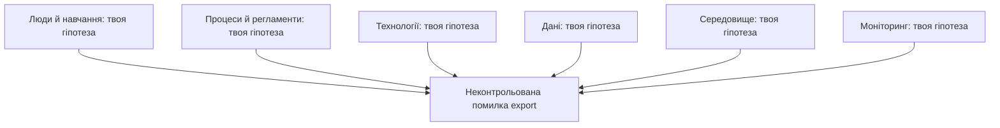

# INC-001 — робочий аркуш RCA та CAPA для студента

Цей аркуш навмисно не містить готових відповідей «5 Чому» чи готових коригувальних
і попереджувальних дій. Методичка ЛР12 вимагає, щоб студент сформував RCA/CAPA сам;
ШІ може перевірити логіку та допомогти з технічними доказами. Нижче структура та джерела.

## Blameless Post-Mortem

Симптом і вплив: заповнити з INC-001.md та FAIL.json. Аналізувати систему і процес,
не особисті помилки. Вказати, що допомогло, що ускладнило діагностику та що змінилося.

## «5 Чому» — щонайменше п'ять рівнів

| Рівень | Твоє причинне пояснення | Доказ: файл/рядок/лог/коміт |
| --- | --- | --- |
| 1 | Заповнити | FAIL.json, response status |
| 2 | Заповнити | routes.py та service.py, legacy-analysis.json |
| 3 | Заповнити | baseline tests та fault injection |
| 4 | Заповнити | попередні ADR/регламент/code review |
| 5 | Заповнити процесну першопричину | документований контроль або його відсутність |

## Діаграма Ісікави — структура гіпотез, не готове RCA

Для кожної гіпотези зазначити verified/assumed, доказ або спосіб перевірки.

## CAPA — три картки, які заповнює студент

| ID | Тип | Опис | Власник | Дедлайн UTC | Статус | Effectiveness check: як і коли |
| --- | --- | --- | --- | --- | --- | --- |
| CA-01 | Коригувальна | Заповнити власним висновком RCA | Vlad8800 | Визначити | Draft | Визначити |
| CA-02 | Коригувальна | Заповнити власним висновком RCA | Vlad8800 | Визначити | Draft | Визначити |
| PA-01 | Попереджувальна | Заповнити для іншого потенційного збою | Vlad8800 | Визначити | Draft | Визначити |

Фактичні технічні зміни та regression уже є у PASS-коміті; студент має оцінити,
чи вони усувають визначену ним причину, і прив'язати їх до власної картки.
Наявність патча не замінює власне пояснення причин та перевірку ефективності.
