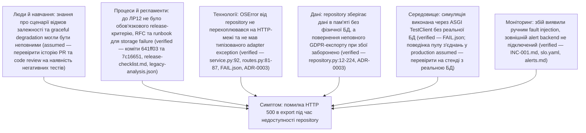

# INC-001 — робочий аркуш RCA та CAPA

## Blameless Post-Mortem

Під час контрольованої симуляції недоступності repository п'ять тестових запитів експорту повернули HTTP 500. Симуляція виконувалась ізольовано через fault injection; реальні користувачі та production-сервіс не зачіпалися. Після усунення збою в коді запити повертали контрольовану відповідь 503 з Retry-After, а після відновлення repository три перевірки завершилися відповідями 200.

Симптом виявили ручним тестовим запитом. Відновленню допомогли ізольований тестовий контекст і можливість повернути залежність без перезапуску сервісу. Діагностику обмежує те, що це локальна симуляція без реального сховища, production-телеметрії та зовнішнього моніторингу. Жодна людина не є причиною інциденту: система не мала достатньо перевіреної поведінки для цієї відмови.

## «5 Чому»

| Рівень | Причинне пояснення | Доказ |
| --- | --- | --- |
| 1 | Експорт повернув 500, бо під час читання даних виник `OSError`, який не був перетворений на контрольовану відповідь API з інструкцією щодо повторної спроби. | `Lab12/evidence/FAIL.json` (`"status": 500`, `"retry_after": null`, `"affected_requests": 5`); `docs/incidents/INC-001.md` |
| 2 | Помилка repository до виправлення проходила через межу маршруту як неочікувана помилка сервера, оскільки в `routes.py` перехоплювалися лише винятки авторизації та пошуку суб'єкта. | `app/export/service.py:92` (`self.repository.get_user_by_id`); `app/export/routes.py:73-98` (у коміті `641ff03` оброблялися лише рядки `88` і `94`, блок `except OSError:` у рядках `81-87` додано в коміті `7c16651`); `Lab12/evidence/legacy-analysis.json` (`source_inventory`); `docs/architecture/adr/0003-export-storage-unavailability.md` |
| 3 | Регресійна перевірка недоступності сховища не була частиною обов'язкового набору тестів до цієї зміни — базові тести перевіряли лише штатний експорт, IDOR і мінімізацію полів. | Коміт `641ff03` (`tests/test_personal_data_export.py` без fault-injection сценарію); регресійний тест `tests/test_lab12_storage_failure.py:8-22` (ін'єкція `OSError` у рядку `12`) додано в коміті `7c16651` (`Lab12/evidence/regression-PASS.log`) |
| 4 | Архітектурні рішення та вимоги до змін до ЛР12 не регламентували поведінку export при відмові зовнішніх залежностей, а документація оновлювалася рідше за код. | Коміт `641ff03` (`ADR-0001`, `ADR-0002` без `ADR-0003`); `docs/architecture/adr/0003-export-storage-unavailability.md` та `docs/changes/RFC-001.md` додано в коміті `7c16651`; `Lab12/evidence/legacy-analysis.json` (`audit_extract` `F019`–`F023`: `"doc_age_days": 30`, `"code_commits_since_doc": 1`, `"ratio": 2.0`) |
| 5 | Процес приймання змін не мав обов'язкового операційного контролю (release checklist, runbook, SLO та алертинг), який пов'язує відмови залежностей із тестом, контрактом API та критерієм release go/no-go. | Історія комітів `641ff03` → `7c16651` (додавання `docs/changes/release-checklist.md`, `docs/changes/CCB-001.md`, `docs/runbooks/RB-001.md`, `docs/slo.yaml`, `docs/operations/alerts.md`); `docs/architecture/adr/0003-export-storage-unavailability.md` |

## Діаграма Ісікави — чинники та гіпотези

Позначення `verified` означає, що твердження підтверджене кодом, тестом або артефактом репозиторію. Позначення `assumed` означає гіпотезу, яку ще потрібно підтвердити.

## CAPA — коригувальні та попереджувальні дії

| ID | Тип | Опис | Власник | Дедлайн UTC | Статус | Effectiveness check |
| --- | --- | --- | --- | --- | --- | --- |
| CA-01 | Коригувальна | На HTTP-межі ендпоїнтів `/api/users/{id}/personal-data` та `/api/v1/users/{id}/personal-data` перехоплювати `OSError` і повертати `HTTP 503` із заголовком `Retry-After: 30` та безпечним повідомленням без діагностики сховища й PII згідно з `ADR-0003` (`app/export/routes.py:81-87`, коміт `7c16651`). | Vlad8800 | 2026-11-21T18:00:00Z | Implemented | Запустити `python scripts/lab12_incident.py` і перевірити `Lab12/evidence/PASS.json`: усі 5 запитів під час ін'єкції мають `status: 503`, `retry_after: "30"`, `pii_in_error: false`, а 3 контрольні проби після відновлення — `[200, 200, 200]` (перевірено 2026-11-20 та перед кожним релізом). |
| CA-02 | Коригувальна | Закріпити регресійний тест недоступності сховища (`tests/test_lab12_storage_failure.py:8-22`) та перевірку відновлення (`scripts/lab12_restore_drill.py`) в обов'язковому наборі перевірок перед випуском змін (`docs/changes/release-checklist.md`, коміт `7c16651`). | Vlad8800 | 2026-11-22T18:00:00Z | Implemented | Виконувати `pytest tests/test_lab12_storage_failure.py` (`Lab12/evidence/regression-PASS.log`) і `python scripts/lab12_restore_drill.py` (`Lab12/evidence/restore-drill.json`) у CI та перед злиттям PR; критерій успіху — 100% проходження перевірок для обох префіксів `/api/users` і `/api/v1/users`. |
| PA-01 | Попереджувальна | Запровадити типізований виняток рівня адаптера сховища (`StorageUnavailableError`) для обробки таймаутів (`TimeoutError`) та помилок з'єднання у всіх методах читання `UserDataRepository` (`get_settings_by_user_id`, `get_activity_by_user_id`, `get_orders_by_user_id`, `get_consents_by_user_id` у `app/export/service.py:121-188`) згідно з обмеженням у `ADR-0003`. | Vlad8800 | 2026-11-28T18:00:00Z | Planned | До 2026-11-28 розширити `tests/test_lab12_storage_failure.py` параметризацією по всіх 5 методах читання репозиторію та імітацією `TimeoutError`, прогнати `pytest` і `python -m mkdocs build --strict` і підтвердити відповідь `503` + `Retry-After: 30` без витоку стектрейсу. |
