# Лабораторна робота 6 — аудит складності алгоритмів

Проєкт: Python/FastAPI, модуль розрахунку вартості доставки. Досліджуваний метод — `calculate_shipping_cost` у `app/services.py`. Дата перевірки: 24 жовтня 2026 року. Докази нижче отримано з цього репозиторію; тест hook виконано в окремому тимчасовому Git-репозиторії з тією самою версією hook і валідатора.

## 1. Аналітичний скринінг за Холстедом

Інструмент: **Radon 6.0.1**, Python CLI. Встановлення: `python -m pip install "radon==6.0.1"`; перевірка версії: `python -m radon --version`. Поточний проєкт декларує залежність `radon>=6.0.1` у `requirements.txt`. Запуск повного аудиту з кореня репозиторію: `.\.venv-1\Scripts\python.exe audit_halstead_mccabe.py`; вибіркова незалежна перевірка: `.\.venv-1\Scripts\python.exe -m radon hal app\services.py app\export\repository.py app\utils.py`.

Глобальний скан охоплює **46 Python-файлів** репозиторію, включно з новим `quality_gate.py`. AST файлів об'єднано перед аналізом, тому `η₁` і `η₂` означають кількість різних операторів і операндів для спільного коду, а не суму кількостей окремих файлів. Виміряно: `η₁=20`, `η₂=902`, `N₁=591`, `N₂=1151`; словник `η=922`, довжина `N=1742`, об'єм `V=17156,30` біт, складність `D≈12,76`, зусилля `E=218923,53`.

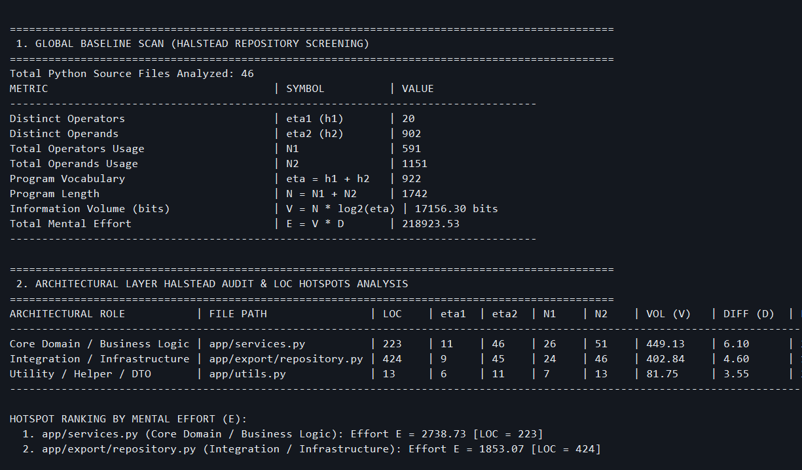

### Порівняння архітектурних ролей

| Роль | Файл | LOC | η₁ | η₂ | N₁ | N₂ | V, біт | D | E |
|---|---|---:|---:|---:|---:|---:|---:|---:|---:|
| Бізнес-логіка | `app/services.py` | 223 | 11 | 46 | 26 | 51 | 449,13 | 6,10 | **2738,73** |
| Інтеграція/сховище | `app/export/repository.py` | 424 | 9 | 45 | 24 | 46 | 402,84 | 4,60 | **1853,07** |
| Утиліти | `app/utils.py` | 13 | 6 | 11 | 7 | 13 | 81,75 | 3,55 | **289,84** |

Формули: `η=η₁+η₂`; `N=N₁+N₂`; `V=N·log₂η`; `D=(η₁/2)·(N₂/η₂)`; `E=V·D`. Наприклад, для бізнес-модуля `η=57`, `N=77`, `V=77·log₂57≈449,13`, `D=(11/2)·(51/46)≈6,10`, `E≈2738,73`.

Ранжування аномалій: **1)** `app/services.py`, **2)** `app/export/repository.py`, **3)** `app/utils.py`. Інтеграційний файл має у **1,90 раза** більше LOC за бізнес-модуль, проте бізнес-модуль має у **1,48 раза** більше розрахункове зусилля. Отже, LOC сам по собі приховав би складнішу для аналізу бізнес-логіку. Це порівняння метрик, а не пряме вимірювання часу роботи конкретного розробника.

## 2. CFG, прогноз і рефакторинг

### Baseline

Стан зафіксовано комітом `c44aa3a chore(audit): establish Lab 6 baseline state`. У схемі `V=25` вузлів, `E=33` ребра, один зв'язний компонент: **CC=E−V+2=33−25+2=10**. Незалежний скан коду цього коміту також дав **CC=10**.

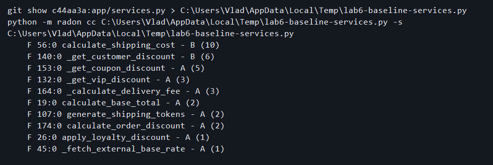

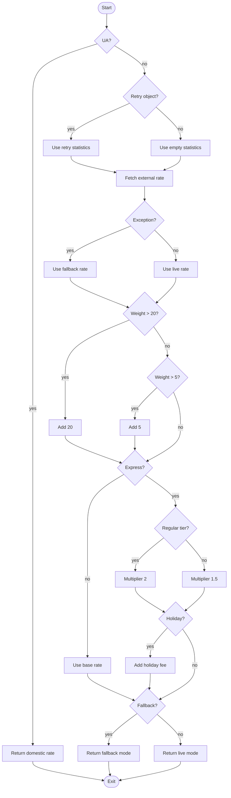

### Розширення правил і FAIL

Початкове формулювання лабораторної пропонує додати «4 предикатні точки та 6 ребер» і водночас перетнути CC>15. Для цього конкретного графа арифметично така добавка дала б лише `CC=(33+6)−(25+4)+2=12`, тобто поріг не було б перетнуто. Тому виконана модель уточнює прогноз: до функції додано **шість фактичних предикатів** (вага понад 30, GB, DE, US, VIP, wholesale). У графі FAIL `V=37`, `E=51`, звідси **CC=51−37+2=16**. Різниця з Baseline становить `ΔCC=6`; збільшення `ΔV=12`, `ΔE=18` включає також лінійні вузли дій. Це пояснює розбіжність із початковим «паперовим» припущенням, а не приховує її.

Монолітний код знаходиться в історичному коміті `5e21045 feat(audit): simulate topological CC failure, FAIL` (`git show 5e21045:app/services.py`). Скан Radon цього коміту підтвердив **CC=16**, тобто ліміт 15 перевищено. У цих двох версіях немає складних виразів `and`/`or`, що додають незалежні шляхи до досліджуваної функції; умовні вирази `x if condition else y` Radon рахує як розгалуження.

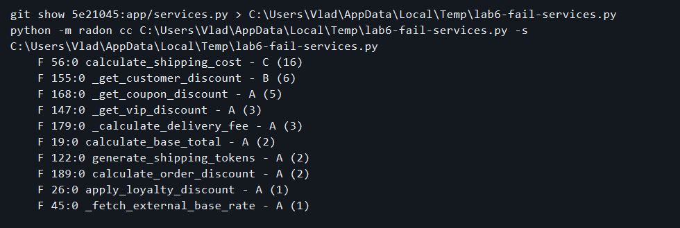

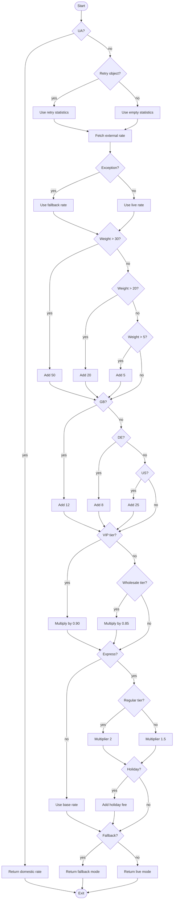

### Lookup Table і PASS

Стан PASS започатковано комітом `6b9d5a7 refactor(audit): eliminate conditional branches using lookup table, PASS`. Поточне доповнення переносить вибір джерела тарифу, формули вартості, надбавки за вагою, express-коефіцієнта і режиму у таблиці `SHIPPING_SOURCE_LOOKUP`, `SHIPPING_COST_LOOKUP`, `WEIGHT_SURCHARGES`, `EXPRESS_RATE_LOOKUP` і `SHIPPING_MODE_LOOKUP` в `app/services.py`. У тілі `calculate_shipping_cost` немає `if`, `elif`, `else`, `switch`, `for` чи `while`; Radon вимірює **CC=1**. Окрема функція стійкості `_fetch_shipping_base_rate` зберігає обробку збою зовнішнього сервісу. Тестовий набір із 49 перевірок проходить.

Порівняння характерних фрагментів:

```python
# До, коміт 5e21045: фізичні розгалуження
if weight > 30.0:
    base_rate += 50.0
elif weight > 20.0:
    base_rate += 20.0
elif weight > 5.0:
    base_rate += 5.0
```

```python
# Після: правило перенесено в дані, вибір виконується за індексом
WEIGHT_THRESHOLDS = (5.0, 20.0)
WEIGHT_SURCHARGES = (0.0, 5.0, 20.0)
weight_surcharge = WEIGHT_SURCHARGES[bisect_right(WEIGHT_THRESHOLDS, weight)]
```

Для функції PASS граф має `V=7`, `E=6`: **CC=6−7+2=1**.

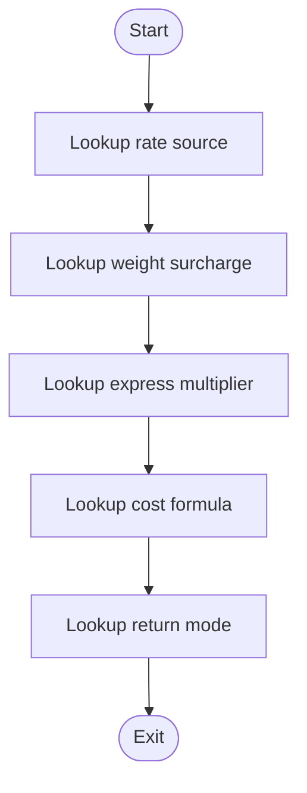

Фактичні результати підрахунку схем і сканування:

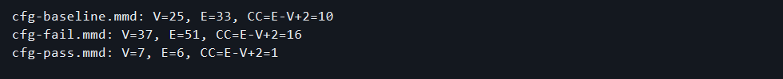
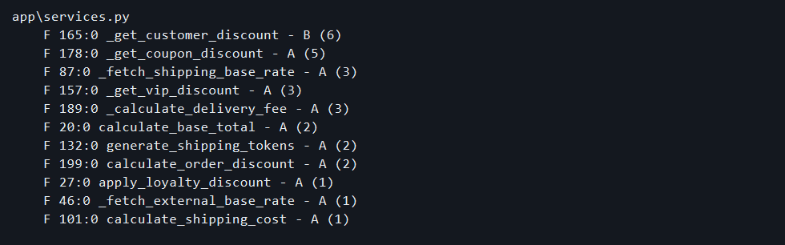

Послідовність комітів Baseline → FAIL → PASS:

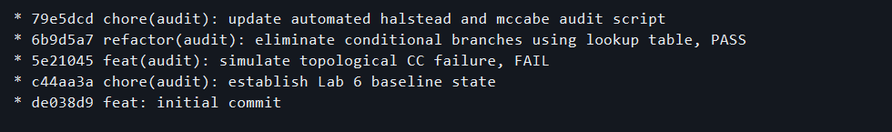

## 3. Локальний Git pre-commit quality gate

Версійний hook міститься у `scripts/pre-commit`; робоча копія встановлена в `.git/hooks/pre-commit`. Повторна інсталяція в PowerShell: `Copy-Item scripts/pre-commit .git/hooks/pre-commit -Force`. Він запускає `quality_gate.py`, який бере список саме staged Python-файлів через `git diff --cached`, читає їхній вміст з індексу через `git show :path`, перевіряє кожну функцію і метод Radon, та повертає `exit 1` при **CC>10** або помилці сканування. За нормальної складності повертає `exit 0`. Червоний колір для FAIL задано ANSI-кодом `\033[31m`.

Повний текст hook:

```sh
#!/bin/sh
# Lab 6: the Python checker reads staged blobs and returns 1 on any violation.
if [ -n "$LAB6_PYTHON" ]; then
    PYTHON_EXEC="$LAB6_PYTHON"
elif [ -f "./.venv-1/Scripts/python.exe" ]; then
    PYTHON_EXEC="./.venv-1/Scripts/python.exe"
else
    PYTHON_EXEC="python"
fi

"$PYTHON_EXEC" quality_gate.py
exit $?
```

Повний текст валідатора:

```python
"""Reject staged Python methods whose Radon cyclomatic complexity exceeds 10."""

import subprocess
import sys

from radon.complexity import cc_visit


LIMIT = 10
RED = "\033[31m"
RESET = "\033[0m"


def git(*args: str) -> bytes:
    return subprocess.check_output(["git", *args], stderr=subprocess.STDOUT)


def staged_python_files() -> list[str]:
    paths = git("diff", "--cached", "--name-only", "-z", "--diff-filter=ACM")
    return [p.decode("utf-8") for p in paths.split(b"\0") if p.endswith(b".py")]


def main() -> int:
    try:
        files = staged_python_files()
        violations = []
        for path in files:
            # Read the index blob: unstaged working-tree edits cannot bypass this gate.
            source = git("show", f":{path}").decode("utf-8-sig")
            for block in cc_visit(source):
                methods = block.methods if hasattr(block, "methods") else [block]
                for method in methods:
                    if method.complexity > LIMIT:
                        violations.append((path, method.name, method.lineno, method.complexity))
    except (OSError, UnicodeError, ValueError, SyntaxError, subprocess.CalledProcessError) as exc:
        print(f"{RED}[FAIL] Quality gate could not scan staged code: {exc}{RESET}", file=sys.stderr)
        return 1

    if violations:
        for path, name, line, complexity in violations:
            print(
                f"{RED}[FAIL] {path}:{line} {name}: CC={complexity} > {LIMIT}{RESET}",
                file=sys.stderr,
            )
        print(f"{RED}[BLOCKED] Commit rejected by cyclomatic complexity gate.{RESET}", file=sys.stderr)
        return 1

    print(f"[PASS] {len(files)} staged Python file(s); all methods have CC <= {LIMIT}.")
    return 0


if __name__ == "__main__":
    raise SystemExit(main())
```

### Експеримент FAIL → PASS

Для безпечної перевірки реального `git commit` створено окремий тимчасовий репозиторій з копіями саме цих hook і валідатора. Після `git add sample.py` функція з 11 послідовними `if` дала **CC=12**. Команда `git commit -m "feat: add messy code"` завершилася з **exit 1**, число комітів залишилося **0**. Після заміни умов на словник `RATES` та повторного `git add` команда `git commit -m "refactor: replace branches with lookup table"` завершилася з **exit 0** і створила коміт `7ab2cb5` у тимчасовому репозиторії.

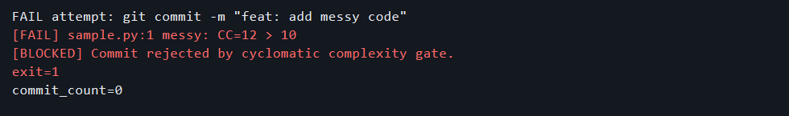
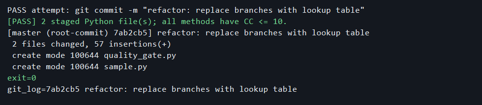

Зображення доказів є **візуалізаціями збереженого фактичного консольного виводу** (`evidence/*.txt`), а не фотографіями вікна термінала. Сирі журнали збережені поряд, щоб перевірити кожен рядок. Демонстрацію викладачу можна повторити за командами вище.

## Висновок

Глобальний і пофайловий аналіз Холстеда показав, що обсяг коду в LOC не визначає складність його аналізу. Топологічний аудит дав перевірений ряд **CC 10 → 16 → 1**. Перенесення бізнес-правил у структури даних прибрало фізичні розгалуження з цільової функції. Локальний hook експериментально блокує staged-код з CC>10 і пропускає варіант після рефакторингу. Історичні коміти Baseline, FAIL і PASS збережені.
