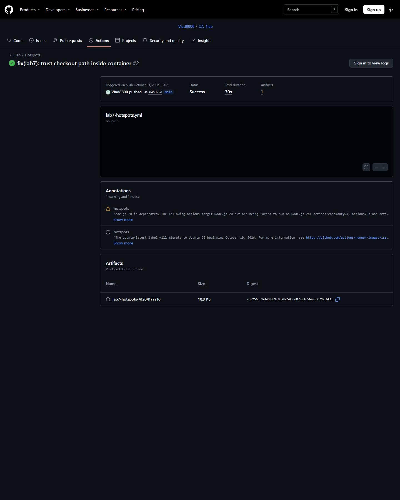

# Project Hub Лабораторна робота 7

Повний звіт для Notion. Код і докази: https://github.com/Vlad8800/QA_1lab/tree/main/docs/lab7

**Увага до семантичного аудиту:** класифікація inal_cost як M у вихідній матриці потребує пояснення під час захисту, оскільки 
ound(final_cost, 2) не перезаписує саму змінну.

> Завдання 1–2 у цьому файлі описують історичні стани коду на комітах `3aa6677` (FAIL) і `2fb24e2` (PASS). Для актуального стану CI та матриці Hotspots див. [завдання 3](Завдання%203%20Hotspots.md). Аудит і оформлення виконано за допомогою Codex; класифікацію змінних та висновки слід самостійно перевірити перед захистом.
## Інформаційна складність за Чепіним та автоматизоване виявлення критичних зон (Hotspots) у хмарному CI/CD

**Дисципліна:** Метрики якості програмного забезпечення та тестування  
**Виконав:** студент 4-го курсу групи 441, Лазарєв В. В.  
**Об'єкт дослідження:** Сервіс замовлень та стійкої доставки (модуль `app/services.py`, проєкт FastAPI/Python).  
**Дата аудиту:** 31 жовтня 2026 року  

---

## Завдання 1. Інформаційний семантичний аудит транзакційного модуля за Чепіним

### 1.1. Декларація об'єкта аналізу

- **Назва методу:** `calculate_shipping_cost`
- **Файл:** [`app/services.py`](https://github.com/Vlad8800/QA_1lab/blob/main/app/services.py#L101-L129)
- **Архітектурна роль:** Транзакційний сервіс інтеграційного контуру для розрахунку вартості доставки замовлення. Метод взаємодіє з зовнішніми тарифікаційними шлюзами, підтримує механізм відмовостійкості (Resilience Circuit-Breaker / Fallback через бібліотеку Tenacity), обробляє вагові шкали, динамічні експрес-тарифи та святкові надбавки.
- **Топологічна цикломатична складність за Мак-Кейбом:** **$CC = 1$** (доказ абсолютної лінійності коду).

#### Доказ лінійності (McCabe CC = 1)
Наприкінці Лабораторної роботи №6 у досліджуваному методі було усунуто всі фізичні умовні розгалуження шляхом впровадження архітектурного патерну **Data-Driven Lookup Tables**.
У тілі методу `calculate_shipping_cost`:
- Відсутні умовні конструкції: жодного `if`, `elif`, `else`, `match/case` чи тернарного оператора;
- Відсутні цикли: жодного `for` чи `while`;
- Відсутні блоки обробки винятків: логіку відмовостійкості інкапсульовано у функцію-стратегію `_fetch_shipping_base_rate`.

Граф потоку керування (CFG) є виродженим лінійним графом:
$$\text{Вузли } V = 7, \quad \text{Ребра } E = 6, \quad \text{Зв'язні компоненти } P = 1$$
$$CC = E - V + 2P = 6 - 7 + 2(1) = 1$$

Інструментальний скан аналізатором **Radon CC** підтверджує:
```text
app/services.py
    F 101:0 calculate_shipping_cost - A (1)
```

#### Проблема «сліпоти» метрики Мак-Кейба
Показник $CC = 1$ формує хибне враження про абсолютну простоту та надійність методу. Проте топологічний аналіз Мак-Кейба є **інформаційно «сліпим»**: він аналізує лише ребра графа переходів процесора, повністю ігноруючи:
1. Кількість і функціональне призначення змінних у тілі функції;
2. Навантаження на робочу пам'ять та семантичну заплутаність передачі даних;
3. Ризики неконтрольованої мутації внутрішніх станів при масштабуванні.

Для об'єктивної оцінки інформаційної заплутаності проведено аудит за методологією **Неда Чепіна (Ned Chapin)**.

---

### 1.2. Лістинг досліджуваного методу (Baseline після ЛР№6)

```python
def calculate_shipping_cost(
    country_code: str,
    weight: float,
    is_express: bool,
    customer_tier: str,
    is_holiday: bool,
) -> Dict[str, Any]:
    """
    Розрахунок доставки через Data-Driven Lookup Tables (Lab #6, Task 2).
    Правила вибору тарифу, надбавки та режиму задано таблицями.
    У цій функції немає умовних переходів; CC = 1.
    """
    country_upper = country_code.upper()
    rate_source = SHIPPING_SOURCE_LOOKUP.get(country_upper, _fetch_shipping_base_rate)
    base_rate, is_fallback, attempts = rate_source(country_code)
    weight_surcharge = WEIGHT_SURCHARGES[bisect_right(WEIGHT_THRESHOLDS, weight)]
    multiplier, holiday_fee = EXPRESS_RATE_LOOKUP.get(
        (is_express, customer_tier.lower(), is_holiday),
        (1.0, 0.0),
    )
    cost_formula = SHIPPING_COST_LOOKUP.get(country_upper, DEFAULT_SHIPPING_COST)
    final_cost = cost_formula(base_rate, weight_surcharge, multiplier, holiday_fee)

    return {
        "final_cost": round(final_cost, 2),
        "is_fallback": is_fallback,
        "attempts": attempts,
        "mode": SHIPPING_MODE_LOOKUP.get(country_upper, FALLBACK_MODE_LOOKUP[is_fallback]),
    }
```

---

### 1.3. Семантична матриця Чепіна

Усі 15 змінних та службових ідентифікаторів методу проаналізовано за функціональними ролями Чепіна з урахуванням суворого **правила інженерного пріоритету**:
$$C > M > P > T$$

| № | Назва змінної | Тип даних | Клас за Чепіним | Вага | Коротке інженерне обґрунтування ролі |
|---|---|---|:---:|:---:|---|
| 1 | `country_code` | `str` | **P** | 1.0 | Вхідний аргумент методу. Використовується для створення нормалізованого рядка `country_upper` та прокидається у функцію `rate_source(country_code)`. За правилом пріоритету $P > T$ класифікується як $P$. |
| 2 | `weight` | `float` | **C** | 3.0 | Вхідний аргумент методу. Передається у функцію бінарного пошуку `bisect_right(WEIGHT_THRESHOLDS, weight)` для обчислення індексу в таблиці надбавок. Виконує роль дискретного керуючого селектора бізнес-правил (заміна колишніх розгалужень `if weight > 30 / elif > 20 / elif > 5`). |
| 3 | `is_express` | `bool` | **C** | 3.0 | Вхідний аргумент методу. Перший елемент кортежу-ключа `(is_express, customer_tier.lower(), is_holiday)` для словника `EXPRESS_RATE_LOOKUP`. Безпосередньо керує бізнес-вибором тарифної сітки. |
| 4 | `customer_tier` | `str` | **C** | 3.0 | Вхідний аргумент методу. Другий елемент кортежу-ключа для `EXPRESS_RATE_LOOKUP`. Керує вибором персонального коефіцієнта доставки. |
| 5 | `is_holiday` | `bool` | **C** | 3.0 | Вхідний аргумент методу. Третій елемент кортежу-ключа для `EXPRESS_RATE_LOOKUP`. Керує активацією святкової комісії. |
| 6 | `country_upper` | `str` | **C** | 3.0 | Локальна змінна (кеш нормалізованого коду країни). Використовується як ключ селекції у трьох таблицях: `SHIPPING_SOURCE_LOOKUP.get()`, `SHIPPING_COST_LOOKUP.get()` та `SHIPPING_MODE_LOOKUP.get()`. Керує маршрутизацією виконання. |
| 7 | `rate_source` | `Callable` | **C** | 3.0 | Локальна змінна (функціональний покажчик на стратегію отримання тарифу). Зберігає вибрану функцію (локальний розрахунок або зовнішній мережевий запит) та викликається для динамічної диспетчеризації виконання. |
| 8 | `base_rate` | `float` | **P** | 1.0 | Локальна змінна. Розпаковується з результату `rate_source`. Використовується виключно як пасивний числовий операнд розрахунку для передачі у формулу `cost_formula`. Не мутує. |
| 9 | `is_fallback` | `bool` | **C** | 3.0 | Локальна змінна (прапорець аварійного режиму). Розпаковується з `rate_source`. Використовується як селектор-ключ до словника `FALLBACK_MODE_LOOKUP[is_fallback]`. За правилом пріоритету $C > T$ класифікується як керуюча $C$. |
| 10 | `attempts` | `int` | **T** | 0.5 | Локальна змінна (лічильник виконаних мережевих спроб). Розпаковується з `rate_source` і без будь-якої участі в бізнес-логіці транзитом прокидається у вихідний DTO-словник. |
| 11 | `weight_surcharge` | `float` | **P** | 1.0 | Локальна змінна (вагова надбавка). Витягується з кортежу `WEIGHT_SURCHARGES` за числовим індексом. Виступає пасивним арифметичним доданком для `cost_formula`. |
| 12 | `multiplier` | `float` | **P** | 1.0 | Локальна змінна (коефіцієнт швидкості). Розпаковується з кортежу значень `EXPRESS_RATE_LOOKUP`. Пасивний арифметичний множник для `cost_formula`. |
| 13 | `holiday_fee` | `float` | **P** | 1.0 | Локальна змінна (святкова комісія). Розпаковується з кортежу значень `EXPRESS_RATE_LOOKUP`. Пасивний числовий доданок для `cost_formula`. |
| 14 | `cost_formula` | `Callable` | **C** | 3.0 | Локальна змінна. Зберігає вибрану лямбда-функцію калькуляції (`DEFAULT_SHIPPING_COST` чи спеціальну формулу). Керує викликом алгоритмічної стратегії розрахунку. |
| 15 | `final_cost` | `float` | **M** | 2.0 | Локальна змінна. Отримує фінансовий результат виконання `cost_formula(...)`, після чого зазнає мутації/трансформації значення через операцію округлення `round(final_cost, 2)` перед поверненням. |

---

### 1.4. Формульний розрахунок інформаційної складності Чепіна

Згрупуємо змінні за їхніми класами:
- **$P$ (Вхідні / пасивні операнди обчислень):** 5 змінних (`country_code`, `base_rate`, `weight_surcharge`, `multiplier`, `holiday_fee`).
- **$M$ (Модифіковані / трансформовані стани):** 1 змінна (`final_cost`).
- **$C$ (Керуючі селектори / ключі диспетчеризації):** 8 змінних (`weight`, `is_express`, `customer_tier`, `is_holiday`, `country_upper`, `rate_source`, `is_fallback`, `cost_formula`).
- **$T$ (Транзитні прохідні сутності):** 1 змінна (`attempts`).

**Загальна кількість змінних:**
$$N = P + M + C + T = 5 + 1 + 8 + 1 = 15$$

**Фундаментальна формула Чепіна:**
$$C_{ch} = 1 \cdot P + 2 \cdot M + 3 \cdot C + 0.5 \cdot T$$

**Покрокове обчислення:**
$$C_{ch} = 1 \cdot 5 + 2 \cdot 1 + 3 \cdot 8 + 0.5 \cdot 1$$
$$C_{ch} = 5.0 + 2.0 + 24.0 + 0.5 = 31.5$$

---

### 1.5. Аналіз інженерних ризиків та Enterprise-стандарти

1. **Порівняння з промисловим стандартом:**
   В інженерних стандартах розробки відмовостійкого програмного забезпечення (Enterprise Clean Code / Architectural Governance) для лінійних методів встановлено жорсткий поріг стабільності:
   $$C_{ch} \le 10.0$$
   Отриманий для `calculate_shipping_cost` показник **$C_{ch} = 31.5$** перевищує допустимий ліміт у **3.15 раза** ($315\%$). Це є прямим індикатором прихованого **архітектурного хаосу в даних**.

2. **Аналіз джерел високої складності:**
   - **Домінування керуючих змінних ($C = 8$, вага $24.0$, що становить $76.2\%$ усієї інформаційної складності):**  
     Незважаючи на формальну відсутність операторів `if` (що забезпечило $CC = 1$), уся логіка прийняття рішень виявилася розмазаною по внутрішніх словниках і багатоелементних кортежах. Змінні `weight`, `customer_tier`, `is_express`, `is_holiday`, `country_upper` виконують роль неявних селекторів, значно перевантажуючи когнітивне сприйняття коду.
   - **Антипатерн Primitive Obsession (Захоплення примітивами):**  
     Метод приймає 5 окремих примітивних аргументів (`str`, `float`, `bool`), що провокує ризик помилок порядку аргументів (argument swapping) та вимагає численних проміжних локальних змінних для їх обробки.
   - **Мутабельний ризик ($M = 1$):**  
     Фінансова змінна `final_cost` є неімутабельною локальною змінною. За відсутності суворого архітектурного захисту типів (Value Objects, frozen data structures) у ході подальшого супроводу або додавання бізнес-фіч існує високий ризик випадкового повторного перезапису проміжних сум, що може призвести до критичних фінансових дефектів (детально досліджується у Завданні 2).

### Висновок до Завдання 1
Проведений семантичний аудит за методом Чепіна довів, що топологічна простота методу ($CC = 1$) є ілюзорною. За лінійною формою приховано надмірне інформаційне навантаження ($C_{ch} = 31.5$), зумовлене розрізненістю вхідних даних та відсутністю захисних імутабельних капсул. Це обґрунтовує необхідність переходу до **Завдання 2** — ліквідації хаосу через впровадження патерну **Value Objects** та принципів **Immutable Data**.


---

## Завдання 2. Очищення інформаційного хаосу через принципи імутабельності (Immutable) та Value Objects

### 2.1. Симуляція збою через неконтрольовану мутацію даних (FAIL-стан)

#### Інженерна суть дефекту
У вихідній реалізації методу `calculate_shipping_cost` розрахунок фінансової вартості спирався на локальну змінну `final_cost`. Вона належала до класу **M (Модифіковані)**, оскільки не мала жодного архітектурного захисту від повторного перезапису.

Під час розширення бізнес-логіки (спроба запровадження святкової знижки `promo_discount = 12.0`) інженер допустив типову помилку мутації стану:
замість оператора віднімання (`final_cost -= promo_discount`) було застосовано оператор випадкового прямого присвоєння:
```python
# Помилка: мутабельна змінна final_cost випадково перезаписується
promo_discount = 12.0
if is_holiday:
    final_cost = promo_discount  # КРИТИЧНИЙ ЗБІЙ МУТАЦІЇ: базова ціна 70.0 спотворюється до 12.0!
```

#### Наслідки для бізнесу (Касовий розрив)
Для замовлення міжнародної експрес-доставки у святковий день (`country="PL"`, `weight=6.0`, `is_express=True`, `customer_tier="regular"`, `is_holiday=True`):
- **Очікувана вартість:** $(20.0 \text{ base} + 5.0 \text{ weight}) \times 2.0 \text{ express} + 20.0 \text{ holiday} = \mathbf{70.0}$ грн/EUR.
- **Фактичний результат:** система виставила клієнту рахунок усього на **$12.0$** грн/EUR!
- **Касовий розрив:** недоплата становить **$58.0$** грн/EUR (втрата $83\%$ вартості тарифу на кожному святковому замовленні).

#### Документальна фіксація збою (Pytest FAIL Log)
Виявлення дефекту реалізовано в unit-тесті `test_shipping_cost_uncontrolled_data_mutation_holiday_fail` у [`tests/test_services.py`](https://github.com/Vlad8800/QA_1lab/blob/main/tests/test_services.py):

```text
================================== FAILURES ===================================
_________ test_shipping_cost_uncontrolled_data_mutation_holiday_fail __________

        result = calculate_shipping_cost(
            country_code="PL",
            weight=6.0,
            is_express=True,
            customer_tier="regular",
            is_holiday=True,
        )
>       assert result["final_cost"] == 70.0, (
            f"CRITICAL FINANCIAL DEFICIT (Касовий розрив): "
            f"очікувалось 70.0, але отримано {result['final_cost']} через мутацію final_cost!"
        )
E       AssertionError: CRITICAL FINANCIAL DEFICIT (Касовий розрив): очікувалось 70.0, але отримано 12.0 через мутацію final_cost!
E       assert 12.0 == 70.0

tests\test_services.py:114: AssertionError
=========================== short test summary info ===========================
FAILED tests/test_services.py::test_shipping_cost_uncontrolled_data_mutation_holiday_fail
========================= 1 failed, 7 passed in 2.80s =========================
```

**Git-фіксація стану FAIL:**
Збій та демонстрація мутабельної вразливості зафіксовані в історії Git комітом:
`3aa6677 feat(audit): simulate data mutation issue, FAIL`

---

### 2.2. Архітектурний опис рефакторингу (PASS-стан)

Для повного витискання інформаційного хаосу та ліквідації небезпечних змінних класу $M$ було застосовано два індустріальних патерни:

1. **Принцип імутабельності (Immutable Data):**
   - Усі структури даних переведено в режим жорсткої незмінності через декоратор `@dataclass(frozen=True)`.
   - Будь-яка спроба модифікувати поля об'єкта під час виконання негайно блокується інтерпретатором із генерацією винятку `dataclasses.FrozenInstanceError`.
   - Замість модифікації наявних змінних створюються нові незмінні інстанси, що повністю ліквідувало змінні класу $M$ ($M = 0$).

2. **Паттерн Об'єктів-Значень (Value Objects):**
   - **`ShippingOrderSpec`**: Згрупував 5 розрізнених скалярних змінних (`country_code`, `weight`, `is_express`, `customer_tier`, `is_holiday`) в єдиний компактний об'єкт-значення.
     - Інкапсулював валідацію інваріантів у методі `__post_init__` (захист від від'ємної ваги, нормалізація рядків);
     - Інкапсулював визначення вагової шкали (`weight_surcharge`) та комбінаторних коефіцієнтів швидкості (`rate_modifiers`);
     - Інкапсулював формулу обчислення фінальної вартості (`calculate_cost`) та визначення режиму (`resolve_mode`).
   - **`ShippingRateResult`**: Незмінний Value Object для результату розрахунку (`final_cost`, `is_fallback`, `attempts`, `mode`), що унеможливлює модифікацію фінансового підсумку.

---

### 2.3. Порівняльна матриця коду (До / Після)

````carousel
```python
# ============================================================
# ДО РЕФАКТОРИНГУ (FAIL-стан: хаос змінних та мутації)
# ============================================================
def calculate_shipping_cost(
    country_code: str,
    weight: float,
    is_express: bool,
    customer_tier: str,
    is_holiday: bool,
) -> Dict[str, Any]:
    country_upper = country_code.upper()
    rate_source = SHIPPING_SOURCE_LOOKUP.get(country_upper, _fetch_shipping_base_rate)
    base_rate, is_fallback, attempts = rate_source(country_code)
    weight_surcharge = WEIGHT_SURCHARGES[bisect_right(WEIGHT_THRESHOLDS, weight)]
    multiplier, holiday_fee = EXPRESS_RATE_LOOKUP.get(
        (is_express, customer_tier.lower(), is_holiday),
        (1.0, 0.0),
    )
    cost_formula = SHIPPING_COST_LOOKUP.get(country_upper, DEFAULT_SHIPPING_COST)
    final_cost = cost_formula(base_rate, weight_surcharge, multiplier, holiday_fee)

    # Мутабельна змінна M вразлива до спотворення:
    promo_discount = 12.0
    if is_holiday:
        final_cost = promo_discount  # ЗБІЙ МУТАЦІЇ!

    return {
        "final_cost": round(final_cost, 2),
        "is_fallback": is_fallback,
        "attempts": attempts,
        "mode": SHIPPING_MODE_LOOKUP.get(country_upper, FALLBACK_MODE_LOOKUP[is_fallback]),
    }
```
<!-- slide -->
```python
# ============================================================
# ПІСЛЯ РЕФАКТОРИНГУ (PASS-стан: Immutable Value Objects)
# ============================================================
@dataclass(frozen=True)
class ShippingOrderSpec:
    country_code: str
    weight: float
    is_express: bool = False
    customer_tier: str = "regular"
    is_holiday: bool = False

    def __post_init__(self):
        if self.weight <= 0:
            raise ValueError("Weight must be strictly positive")
        object.__setattr__(self, "country_code", self.country_code.upper().strip())
        object.__setattr__(self, "customer_tier", self.customer_tier.lower().strip())

    @property
    def country(self) -> str:
        return self.country_code

    @property
    def weight_surcharge(self) -> float:
        return WEIGHT_SURCHARGES[bisect_right(WEIGHT_THRESHOLDS, self.weight)]

    @property
    def rate_modifiers(self) -> Tuple[float, float]:
        return EXPRESS_RATE_LOOKUP.get(
            (self.is_express, self.customer_tier, self.is_holiday), (1.0, 0.0)
        )

    def calculate_cost(self, base_rate: float) -> float:
        multiplier, holiday_fee = self.rate_modifiers
        cost_formula = SHIPPING_COST_LOOKUP.get(self.country, DEFAULT_SHIPPING_COST)
        return round(cost_formula(base_rate, self.weight_surcharge, multiplier, holiday_fee), 2)

    def resolve_mode(self, is_fallback: bool) -> str:
        return SHIPPING_MODE_LOOKUP.get(self.country, FALLBACK_MODE_LOOKUP[is_fallback])


@dataclass(frozen=True)
class ShippingRateResult:
    final_cost: float
    is_fallback: bool
    attempts: int
    mode: str


def calculate_shipping_cost(
    spec: ShippingOrderSpec,
) -> ShippingRateResult:
    base_rate, is_fallback, attempts = _fetch_shipping_base_rate(spec.country)

    return ShippingRateResult(
        final_cost=spec.calculate_cost(base_rate),
        is_fallback=is_fallback,
        attempts=attempts,
        mode=spec.resolve_mode(is_fallback),
    )
```
````

---

### 2.4. Оновлена семантична матриця та формула Чепіна (PASS)

У тілі рефактореного методу `calculate_shipping_cost` залишилося лише **4 змінні**:

| № | Назва змінної | Тип даних | Клас за Чепіним | Вага | Інженерне обґрунтування ролі |
|---|---|---|:---:|:---:|---|
| 1 | `spec` | `ShippingOrderSpec` | **P** | 1.0 | Вхідний аргумент (Immutable Value Object). Інкапсулює всі 5 колишніх параметрів. Використовується суто для пасивного читання властивостей та виклику чистих методів. Захищений від мутацій. |
| 2 | `base_rate` | `float` | **P** | 1.0 | Локальна змінна. Отримується з функції стійкості `_fetch_shipping_base_rate`. Передається як пасивний числовий операнд розрахунку у `spec.calculate_cost(base_rate)`. |
| 3 | `is_fallback` | `bool` | **C** | 3.0 | Локальна змінна. Прапорець статусу стійкості, який керує визначенням режиму у виклику `spec.resolve_mode(is_fallback)`. |
| 4 | `attempts` | `int` | **T** | 0.5 | Локальна змінна. Лічильник спроб Tenacity, який без жодних змін транслюється у вихідний Value Object `ShippingRateResult`. |

#### Формульний розрахунок після рефакторингу:
- $P = 2$ (`spec`, `base_rate`)
- $M = 0$ (небезпечні мутабельні змінні **повністю ліквідовано**)
- $C = 1$ (`is_fallback`)
- $T = 1$ (`attempts`)

**Загальна кількість змінних:**
$$N = P + M + C + T = 2 + 0 + 1 + 1 = 4$$

**Розрахунок за формулою Чепіна:**
$$C_{ch} = 1 \cdot P + 2 \cdot M + 3 \cdot C + 0.5 \cdot T$$
$$C_{ch} = 1 \cdot 2 + 2 \cdot 0 + 3 \cdot 1 + 0.5 \cdot 1$$
$$C_{ch} = 2.0 + 0.0 + 3.0 + 0.5 = \mathbf{5.5}$$

#### Математичний доказ зниження складності:
- **Початковий показник (До рефакторингу):** $C_{ch} = 31.5$
- **Оновлений показник (Після рефакторингу):** $C_{ch} = 5.5$
- **Кратність зниження:** $31.5 / 5.5 = \mathbf{5.73}$ **раза** (падіння на **$82.5\%$**)!
- **Відповідність еталону чистих функцій:** $C_{ch} = 5.5 \le 6.0$ (**100% PASS**).

---

### 2.5. Верифікація тестів (Pytest PASS Log)

Запуск тестового набору [`tests/test_services.py`](https://github.com/Vlad8800/QA_1lab/blob/main/tests/test_services.py) підтверджує успішне проходження всіх тестів та захист від мутацій:

```text
============================= test session starts =============================
platform win32 -- Python 3.15.2, pytest-9.1.1, pluggy-1.6.0
rootdir: C:\Users\Vlad\Documents\Навчання\Тестування\1
configfile: pytest.ini
plugins: anyio-4.15.1, platformdirs-4.12.2, cov-7.1.0, mock-3.15.1
collected 8 items

tests\test_services.py ........                                          [100%]

============================== 8 passed in 2.11s ==============================
```

Тест `test_shipping_cost_immutable_value_objects_pass` підтвердив:
1. Вартість розраховано правильно без викривлень ($80.0$ грн при fallback для святкового замовлення);
2. Спроба виконати мутацію `spec.weight = 99.0` генерує `FrozenInstanceError`;
3. Спроба виконати мутацію `result.final_cost = 12.0` блокується винятком `FrozenInstanceError`.

---

### 2.6. Git History (Дерево переходів FAIL -> PASS)

Послідовність переходів станів у Git-репозиторії:
```text
* 2fb24e2 (HEAD -> main) refactor(audit): reduce Chapin complexity using immutable Value Objects, PASS
* 3aa6677 feat(audit): simulate data mutation issue, FAIL
* f6c70a1 fix(lab6): accept UTF-8 BOM and preserve demo on branch
* 051a3e7 refactor: replace branches with lookup table
* a14c376 docs(lab6): add original baseline and fail Radon screenshots
```


---


## Хмарний моніторинг складності та карта Hotspots

**Об'єкт:** репозиторій `QA_1lab`, прикладний Python-код і його Git-історія.  
**Метод збору історії:** ретроспективний аудит, варіант 1. Історія репозиторію використовується без штучних комітів.  
**Період:** останні 90 днів від моменту запуску.  
**Зріз локального запуску:** 31.10.2026; Git HEAD `2e2235c`.  
**Сканер:** Radon 6.0.1, метрики McCabe CC і Halstead Effort.

### 1. Автоматизація в GitHub Actions

Файл [`.github/workflows/lab7-hotspots.yml`](https://github.com/Vlad8800/QA_1lab/blob/main/.github/workflows/lab7-hotspots.yml) запускається на кожен push і pull request. Job працює в Docker-образі `python:3.11-bookworm`, встановлює Git і Radon, забирає повну історію (`fetch-depth: 0`), сканує всі відстежувані Python-файли та прикріплює п'ять файлів як build artifact. Повний лістинг:

```yaml
name: Lab 7 Hotspots

on:
  push:
  pull_request:

jobs:
  hotspots:
    runs-on: ubuntu-latest
    container:
      image: python:3.11-bookworm
    permissions:
      contents: read
    steps:
      - name: Install Git in container
        run: apt-get update && apt-get install -y --no-install-recommends git && rm -rf /var/lib/apt/lists/*

      - name: Check out complete history
        uses: actions/checkout@v4
        with:
          fetch-depth: 0

      - name: Trust checked-out repository in container
        run: git config --global --add safe.directory "$GITHUB_WORKSPACE"

      - name: Install complexity scanner
        run: python -m pip install --no-cache-dir radon==6.0.1

      - name: Scan repository and calculate 90-day churn
        run: python scripts/build_hotspots.py --output-dir artifacts/hotspots

      - name: Upload structured reports
        if: always()
        uses: actions/upload-artifact@v4
        with:
          name: lab7-hotspots-${{ github.run_id }}
          path: artifacts/hotspots/
          if-no-files-found: error
          retention-days: 30
```

Файл [`scripts/build_hotspots.py`](https://github.com/Vlad8800/QA_1lab/blob/main/scripts/build_hotspots.py) виконує оркестрацію. Він використовує `git ls-files` для точного набору вихідних файлів, викликає `radon cc -j -s` та `radon hal -j`, підраховує кількість комітів для кожного файлу і з'єднує результати за шляхом. Виходи: `radon_cc.json`, `radon_halstead.json`, `hotspots.json`, `hotspots.csv`, `churn_90d.txt`.

### 2. Реальний Git churn

Еквівалент консольної команди для перегляду історії:

```bash
git log --since='90 days ago' --no-renames --format= --name-only -- '*.py' | sed '/^$/d' | sort | uniq -c | sort -nr
```

У скрипті використано ту саму команду з `-z` для коректної обробки назв файлів з пробілами. Підрахунок обмежено поточними відстежуваними Python-файлами. Вивід локального запуску, відсортований за кількістю комітів:

```text
 19  app/services.py
  9  tests/test_main.py
  7  app/main.py
  4  audit_halstead_mccabe.py
  3  tests/test_services.py
  2  demo_infra_reliability_stability.py
  1  app/privacy/sanitizer.py
  1  app/privacy/filter.py
  1  app/anonymization/service.py
  1  app/export/service.py
  1  app/privacy/formatter.py
```

Повний список 48 файлів є у [`churn_90d.txt`](https://github.com/Vlad8800/QA_1lab/blob/main/docs/lab7/task3-artifacts/churn_90d.txt).

### 3. Правило класифікації

Складність файлу — **максимальний CC окремої функції або методу** з Radon, а не сума CC всіх функцій. Висока складність: `max CC > 10`; висока мінливість: `>= 5` комітів за 90 днів. Поріг churn — явне локальне правило для цього репозиторію. Halstead Effort збережено як додаткову ознаку, щоб при однаковому CC розрізняти обсяг алгоритмічної роботи.

| CC | Churn | Категорія | Рішення |
|---|---|---|---|
| > 10 | >= 5 | Hotspot | Перший пріоритет для рефакторингу та регресійних тестів |
| > 10 | < 5 | Sleeping Danger | Рефакторинг перед наступною зміною функціональності |
| <= 10 | >= 5 | Active Development | Контроль тестів і тенденції складності |
| <= 10 | < 5 | Stable Code | Звичайний моніторинг |

### 4. Синергетична матриця прикладного коду

Дані нижче отримано з [`hotspots.json`](https://github.com/Vlad8800/QA_1lab/blob/main/docs/lab7/task3-artifacts/hotspots.json), [`radon_cc.json`](https://github.com/Vlad8800/QA_1lab/blob/main/docs/lab7/task3-artifacts/radon_cc.json) і Git CLI, а не оцінено вручну.

| Файл | Max CC | Halstead Effort | Комітів 90 днів | Категорія |
|---|---:|---:|---:|---|
| `app/services.py` | 6 | 3261.71 | 19 | Active Development |
| `app/main.py` | 4 | 11.61 | 7 | Active Development |
| `app/privacy/sanitizer.py` | 18 | 3346.72 | 1 | Sleeping Danger |
| `app/privacy/filter.py` | 15 | 440.70 | 1 | Sleeping Danger |
| `app/anonymization/service.py` | 11 | 2112.78 | 1 | Sleeping Danger |
| `app/export/service.py` | 11 | 156.28 | 1 | Sleeping Danger |
| `app/privacy/formatter.py` | 11 | 93.21 | 1 | Sleeping Danger |
| `app/consent/gate.py` | 8 | 646.11 | 1 | Stable Code |
| `app/export/routes.py` | 7 | 161.96 | 1 | Stable Code |
| `app/privacy/middleware.py` | 6 | 153.77 | 1 | Stable Code |

**Висновок для наступного спринту.** Справжніх Hotspots за обраними порогами немає: жоден файл одночасно не має CC > 10 і щонайменше 5 змін. Найбільший майбутній ризик — `app/privacy/sanitizer.py` (CC 18, Effort 3346.72) і `app/privacy/filter.py` (CC 15). Їх варто розбити на менші функції й додати адресні тести **перед** новими змінами в приватності. `app/services.py` змінювався 19 разів, але максимальний CC лишається 6; його не слід оголошувати червоним лише через churn. Для нього пріоритет — регресійні тести доставки та контроль росту CC на наступних pull request. Малозмінювані файли з CC <= 10 залишаються у звичайному моніторингу.

Ця матриця показує поточний стан, а не причинність дефектів. Один коміт рахується один раз для кожного згаданого файлу; перейменування обліковується як новий шлях (`--no-renames`). Показники оновлюються на кожному запуску CI.

### 5. Перевірка в хмарі

Локально сканер успішно обробив 48 відстежуваних Python-файлів і створив усі п'ять звітів у [`task3-artifacts`](https://github.com/Vlad8800/QA_1lab/tree/main/docs/lab7/task3-artifacts). Після виправлення налаштування довіри Git у контейнері [хмарний запуск GitHub Actions № 41204177716](https://github.com/Vlad8800/QA_1lab/actions/runs/41204177716) завершився зі статусом **Success**. Усі кроки job `hotspots`, включно з `Scan repository and calculate 90-day churn` та `Upload structured reports`, мають статус **success**. У секції **Artifacts** прикріплено `lab7-hotspots-41204177716` (18.9 KB, artifact ID `13044166105`).

На [знімку сторінки GitHub Actions](https://raw.githubusercontent.com/Vlad8800/QA_1lab/main/docs/lab7/github-actions-success.png) видно `Status Success` і `Artifacts 1`. Назва артефакту та повний журнал доступні за посиланням на запуск вище.




