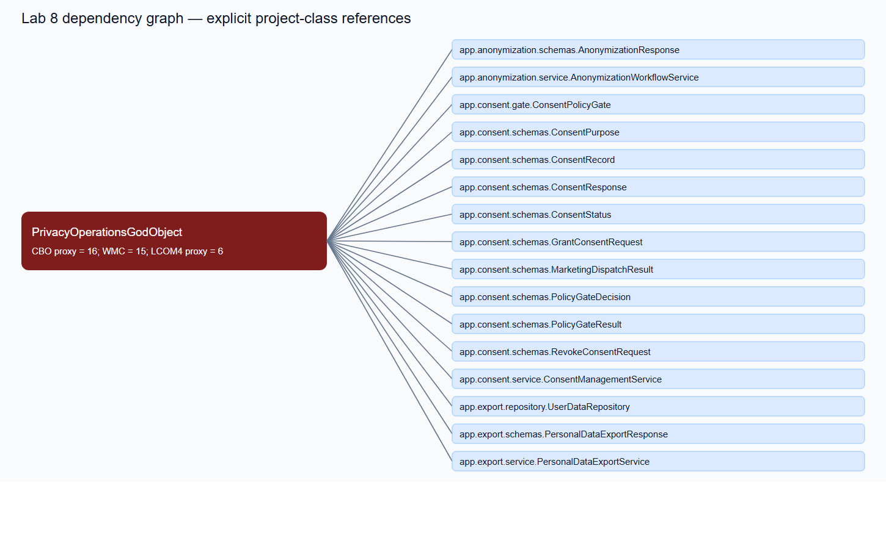
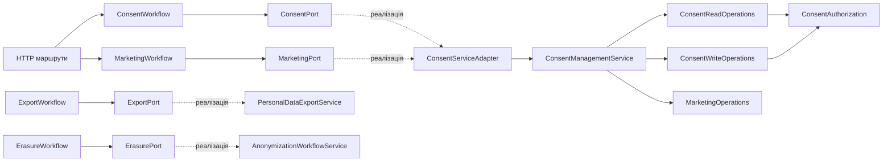
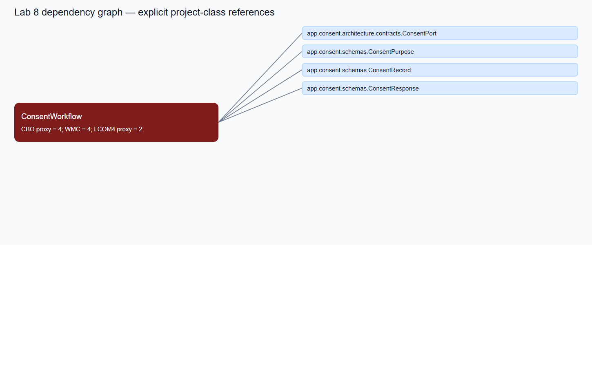

# Лабораторна робота 8 — завдання 2

## Об'єкт дослідження та метод

Досліджено GDPR-підсистему власного проєкту [`QA_1lab`](https://github.com/Vlad8800/QA_1lab/tree/lab8-architecture). У [завданні 1](Завдання%201%20ООП%20паспорт%20SonarCloud.md) локальний AST-аудит не виявив природного класу з CBO proxy > 15. Тому використано дозволений методичкою **метод штучної агрегації**: у контрольному Baseline згоди, маркетингову відправку, експорт та видалення даних об'єднано в `PrivacyOperationsGodObject`. Робочий HTTP-маршрут `/api/marketing/dispatch` на цьому стані викликав моноліт. Після експерименту клас видалено, маршрут переведено на вузькі контракти.

Важлива межа доказу: SonarCloud цього Python-проєкту не має ключів `coupling_between_objects` і `lcom4` у REST API; [сирий запит і відповідь сервера](task1-artifacts/sonar_api_baseline.json) це фіксують. Далі наведено відтворювані **локальні AST/Radon proxy**, а не приписані SonarCloud числа. SonarCloud `complexity` є метрикою файлу і не замінює CBO/LCOM класу.

## 1. Baseline — епіцентр зв'язності

Коміт [`59b6318`](https://github.com/Vlad8800/QA_1lab/commit/59b6318) містить контрольний моноліт і його граф. [`coupling_matrix.csv`](task2-artifacts/baseline/coupling_matrix.csv) — повна матриця спрямованих посилань класів. [`oo_metrics.json`](task2-artifacts/baseline/oo_metrics.json) — первинний машинозчитуваний зріз. Схему згенеровано з AST, тому кожна стрілка має відповідне ім'я класу в JSON. PNG нижче — знімок цього графа, не скріншот інтерфейсу SonarCloud чи IDE.



У Baseline `PrivacyOperationsGodObject` безпосередньо знає 16 класів, зокрема `ConsentManagementService`, `ConsentPolicyGate`, `PersonalDataExportService`, `AnonymizationWorkflowService`, `UserDataRepository` та низку DTO. За локальними правилами: WMC (сума Radon CC методів) = **15**, CBO proxy (різні іменовані класи проєкту) = **16**, LCOM4 proxy = **6** компонентів. Після виключення конструктора нормалізована оцінка незв'язності = **0,625**. Чотири види операцій мають різні причини змін і не повинні жити в одному класі.

Baseline перевірено в Python 3.11 Docker-контейнері: 9 профільних тестів пройшли.

## 2. Контрольований FAIL — Shotgun Surgery

Коміт [`76b4f0a`](https://github.com/Vlad8800/QA_1lab/commit/76b4f0a) змінює тільки зовнішній контракт `ConsentManagementService.grant_consent`: назву параметра `policy_version` замінено на `agreement_version`. Контрольний моноліт і HTTP-маршрут передавали старий іменований аргумент:

```python
# God Object у Baseline / FAIL
self.consent.grant_consent(policy_version=request.policy_version, ...)

# Залежний сервіс після точкової зміни
def grant_consent(..., agreement_version: str, ...):
    ...
```

Результат — `TypeError: ConsentManagementService.grant_consent() got an unexpected keyword argument 'policy_version'`. У [`pytest.log`](task2-artifacts/fail/pytest.log) зафіксовано **4 failed, 5 passed**, [`result.txt`](task2-artifacts/fail/result.txt) — код завершення 1. Падіння зачепило перевірку моноліту та кілька HTTP-сценаріїв. Це навмисний, окремий FAIL-коміт; зміна сигнатури збережена і в PASS, щоб продемонструвати локалізацію адаптації.

## 3. PASS — інтерфейсна декомпозиція

Коміт [`0190df8`](https://github.com/Vlad8800/QA_1lab/commit/0190df8) видаляє `PrivacyOperationsGodObject` і вводить чотири малі класи з окремими обов'язками. Додатковий [коміт `9c401a9`](https://github.com/Vlad8800/QA_1lab/commit/9c401a9) переносить також **реальну бізнес-логіку** зі старого `ConsentManagementService` у компоненти читання, зміни згод, маркетингу й авторизації. Старий клас залишено лише як сумісний фасад для викликів чинного API.

| Компонент | Обов'язок | Контракт конструктора |
|---|---|---|
| `ConsentWorkflow` | читання, надання й відкликання згод | `ConsentPort` |
| `MarketingWorkflow` | маркетингова відправка | `MarketingPort` |
| `ExportWorkflow` | експорт персональних даних | `ExportPort` |
| `ErasureWorkflow` | видалення/анонімізація | `ErasurePort` |

Абстрактні контракти — Python `Protocol` у [`contracts.py`](../../app/consent/architecture/contracts.py). Залежності вводяться через конструктори. [`ConsentServiceAdapter`](../../app/consent/architecture/adapter.py) є єдиним місцем, де стабільний аргумент `version` перекладається на новий `agreement_version` конкретного сервісу. [`routes.py`](../../app/consent/routes.py) використовує `ConsentWorkflow` і `MarketingWorkflow`; маршрут більше не знає зміненої сигнатури.



Повна PASS-матриця — [`coupling_matrix.csv`](task2-artifacts/pass/coupling_matrix.csv), машинозчитуваний зріз — [`oo_metrics.json`](task2-artifacts/pass/oo_metrics.json), фокусний граф:



| Стан / клас | WMC Radon | CBO proxy | LCOM4 компонентів без конструктора | Нормалізований LCOM4 proxy |
|---|---:|---:|---:|---:|
| Baseline `PrivacyOperationsGodObject` | 15 | **16** | 6 | **0,625** |
| PASS `ConsentWorkflow` | 4 | **4** | 1 | **0,000** |
| PASS `MarketingWorkflow` | 2 | 2 | 1 | 0,000 |
| PASS `ExportWorkflow` | 2 | 2 | 1 | 0,000 |
| PASS `ErasureWorkflow` | 2 | 2 | 1 | 0,000 |
| PASS `ConsentServiceAdapter` | 5 | 2 | — | — |

Після перенесення внутрішньої логіки WMC старого `ConsentManagementService` знизився з **24 до 9**, а CBO proxy — з **9 до 7**. Нові внутрішні компоненти мають WMC/CBO: `ConsentReadOperations` **5/5**, `ConsentWriteOperations` **12/6**, `MarketingOperations` **6/4**, `ConsentAuthorization` **3/1**. Отже, серед оновлених компонентів цієї підсистеми найбільший CBO proxy = **7 ≤ 8**. Це не просто рознесення викликів фасаду: реалізації читання, зміни та перевірки відправки фізично перенесені у [`operations.py`](../../app/consent/architecture/operations.py).

Максимум для чотирьох нових робочих класів знизився з **16 до 4** зв'язків, тобто у **4 рази**, і задовольняє заданий орієнтир CBO ≤ 8 **за локальним proxy**. Нормалізований proxy дорівнює 0,000 ≤ 0,2. Його формула: `(кількість компонентів зв'язності методів − 1) / (кількість робочих методів − 1)`; для класу з одним робочим методом значення 0. Конструктори й службові `__dunder__` методи не враховано. [Сирі обчислення для обох Git-станів](task2-artifacts/lcom_comparison.json) отримані скриптом [`lab8_lcom_comparison.py`](../../scripts/lab8_lcom_comparison.py). Це визначена нами нормалізація для порівняння, **не офіційна метрика SonarCloud**.

Фінальна перевірка всього проєкту в Python 3.11 Docker-контейнері: **52 passed**, код завершення 0 — [`pytest.log`](task2-artifacts/pass/pytest.log). Локальний Git hook також підтвердив CC ≤ 10 для нових методів. Згоди й маркетинг перевірені через HTTP-сценарії; експорт і видалення — окремим інтеграційним тестом композиції.

## 4. Хмарне сканування і межа інструменту

Гілку `lab8-architecture` додано до [SonarCloud workflow](../../.github/workflows/sonarcloud.yml). [Повторне сканування фінального коду `9c401a9`](https://github.com/Vlad8800/QA_1lab/actions/runs/41219489182) завершилося **Success**. SonarCloud зареєстрував аналіз гілки `2026-10-31T18:24:35+02:00`, SHA `9c401a92c166caafd6300081ad86c36f093a9aa8`. REST API повернув для `app/consent/architecture/workflows.py` `complexity=10`, для `adapter.py` — 5, для `operations.py` — 26, для сумісного `app/consent/service.py` — 9. Це **файлові**, а не класові показники. [Сирий PASS JSON](task2-artifacts/pass/sonar_api/sonar_api_pass.json) містить URL кожного запиту, HTTP-статуси, файлові дані та повторну відповідь HTTP 404 на запит CK-ключів.

Відтворення PASS-запиту:

```powershell
.\.venv-1\Scripts\python.exe scripts\lab8_fetch_sonar.py --branch lab8-architecture --output-dir docs/lab8/task2-artifacts/pass/sonar_api --file app/consent/architecture/workflows.py --file app/consent/architecture/adapter.py --file app/consent/architecture/contracts.py --file app/consent/architecture/operations.py --file app/consent/routes.py --file app/consent/service.py
```

Навіть після успішного сканування цей SonarCloud не видає офіційні CBO/LCOM: ключів немає в каталозі метрик сервера. Цю неможливість слід показати викладачу разом із HTTP 404 та запропонувати локальний AST/Radon аналіз як інструментальну альтернативу. Без такого погодження буквальну вимогу «PASS CK JSON через SonarQube Web API» підтвердити не можна. Штучно агрегований God Object видалено; бізнес-рішення старого `ConsentManagementService` також розділено, але інші класи проєкту не входили до цього експерименту.

## 5. Git History і відтворення

[`git_history.txt`](task2-artifacts/git_history.txt) і три послідовні коміти показують потрібні стани:

```text
59b6318 arch(audit): baseline synthetic privacy god object
76b4f0a arch(audit): capture god object coupling failure, FAIL
0190df8 refactor(audit): eliminate god object via interface decomposition, PASS
9c401a9 refactor(lab8): extract consent decisions from compatibility facade
```

Команди з папки `C:\Users\Vlad\Documents\Навчання\Тестування\8`:

```powershell
git log --graph --oneline -5
git show 59b6318:app/consent/privacy_god_object.py
git show 76b4f0a:app/consent/service.py
git show 0190df8:app/consent/architecture/workflows.py
Get-Content docs\lab8\task2-artifacts\fail\pytest.log
Get-Content docs\lab8\task2-artifacts\pass\pytest.log
docker run --rm -v "${PWD}:/workspace" -w /workspace --entrypoint python lab8-test-env:latest -m pytest -q --tb=short -p no:warnings
```

`lab8-test-env` — локальний тестовий образ Python 3.11. Для запуску на іншому ноутбуці достатньо створити Python 3.11 середовище, встановити `requirements.txt` і `pytest-mock`, після чого запустити `python -m pytest -q`.

## Протокол використання ШІ

На прохання студента Codex підготував контрольну агрегацію, FAIL-експеримент, інтерфейсну декомпозицію, скрипти вимірювання та цей звіт. Інженерні твердження перевірено Git-комітами, сирими JSON, матрицями, логами тестів і хмарним скануванням. Перед захистом студент має самостійно переглянути код, пояснити причину `TypeError`, роль кожного `Protocol`, формулу локальних proxy і межу SonarCloud. Методичка передбачає штраф за виконання рефакторингу ШІ у форматі Live Demo; цей факт не приховано, тому максимальний бал гарантувати не можна.
