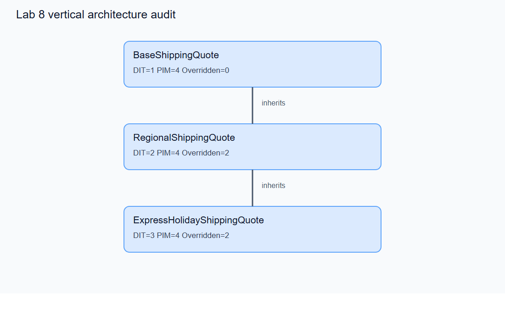
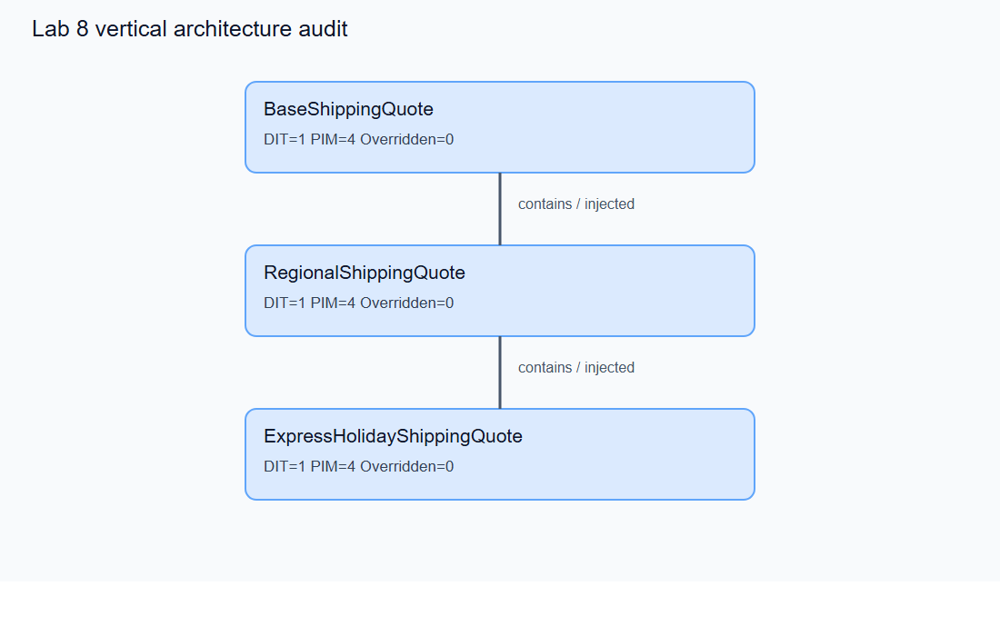
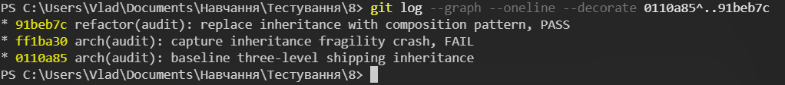
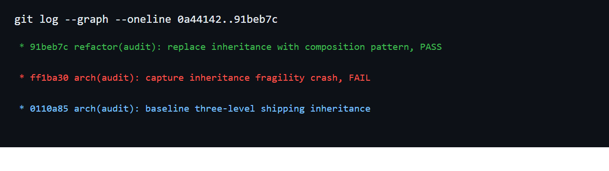

# Лабораторна робота 8 — завдання 3

## Об'єкт, метод і межі вимірювання

У власному коді проєкту переважає успадкування від бібліотечних `BaseModel`, `Enum`, `Exception` та компонентів FastAPI. Трирівневого ланцюга власних бізнес-сервісів не було, тому застосовано прямо дозволений методичкою **контрольний Baseline** для правил розрахунку доставки. Додано реальний HTTP-маршрут `/api/v1/orders/quote-with-policy`; наявний маршрут і код лабораторної №7 не змінювалися.

Метрики DIT, PIM та Overridden отримано відтворюваним AST-скриптом [`lab8_inheritance_audit.py`](../../scripts/lab8_inheritance_audit.py). Незалежна [перевірка через реальний Python MRO](task3-artifacts/runtime_dit_validation.json) підтверджує ті самі числа для коду Baseline з коміту та поточного PASS; її виконує [`lab8_runtime_dit.py`](../../scripts/lab8_runtime_dit.py). Правило DIT: клас без батька всередині досліджуваної ієрархії має глибину **1**; кожен явний рівень успадкування додає 1. PIM — кількість різних публічних методів класу разом з успадкованими. Overridden — методи класу з іменами, що вже є у предків. Метрика не враховує неявні механізми Python поза аналізованим модулем.

SonarCloud для цього Python-проєкту не надає числового DIT через REST API. У [сирому Baseline JSON](task3-artifacts/baseline/sonar_api/sonar_api_baseline.json) запит `metricKeys=dit` має HTTP 200, але порожній масив `measures`; ключ `dit` також відсутній у каталозі `/api/metrics/search`. [Представник SonarSource](https://community.sonarsource.com/t/sonarqube-can-calculate-ck-metrics/30697) окремо зазначав, що штатний SonarQube не обчислює CK-метрики. Тому локальний DIT не видається за результат SonarCloud.

## 1. Baseline — вертикальний аудит

Коміт [`0110a85`](https://github.com/Vlad8800/QA_1lab/commit/0110a85) фіксує трирівневу ієрархію [`app/shipping_policy.py`](../../app/shipping_policy.py). Початковий код доступний через `git show 0110a85:app/shipping_policy.py`. [`inheritance_metrics.json`](task3-artifacts/baseline/inheritance_metrics.json) містить виміряні значення, а рисунок нижче — знімок графа, побудованого з AST.



| Клас | DIT | PIM | Додані публічні методи | Перевизначені методи |
|---|---:|---:|---:|---|
| `BaseShippingQuote` | 1 | 4 | 4 | 0 |
| `RegionalShippingQuote` | 2 | 4 | 0 | 2: `supports`, `quote` |
| `ExpressHolidayShippingQuote` | **3** | **4** | 0 | 2: `quote`, `mode` |

На кожному рівні нащадок переписує **2 із 4** публічних операцій, тобто половину інтерфейсу. DIT досягає аномального орієнтира 3. PIM=4, що **нижче** орієнтира >20; штучно додавати 17 непотрібних методів не стали. Ризик цього кейсу — глибина й повторні `super()`-виклики, а не надмірний розмір інтерфейсу. У Baseline повний набір тестів: **56 passed** — [`pytest.log`](task3-artifacts/baseline/pytest.log).

```python
# Baseline — зв'язок через успадкування
class RegionalShippingQuote(BaseShippingQuote):
    def quote(self, spec, base_rate):
        return super().quote(spec, base_rate)

class ExpressHolidayShippingQuote(RegionalShippingQuote):
    def quote(self, spec, base_rate):
        amount = super().quote(spec, base_rate)
        ...
```

## 2. FAIL — каскадне руйнування

У коміті [`ff1ba30`](https://github.com/Vlad8800/QA_1lab/commit/ff1ba30) змінено **одну сигнатуру** на верхньому рівні:

```python
# BaseShippingQuote після зміни
def quote(self, spec, base_rate, *, policy_context: str):
    ...
```

Обидва нащадки викликали `super().quote(spec, base_rate)` без нового обов'язкового аргументу. [`pytest.log`](task3-artifacts/fail/pytest.log) показує ланцюжок `ExpressHolidayShippingQuote → RegionalShippingQuote → BaseShippingQuote` і `TypeError: BaseShippingQuote.quote() missing 1 required keyword-only argument: 'policy_context'`. Впали тести середнього рівня, нижнього рівня й HTTP-маршруту: **3 failed, 53 passed**; код завершення 1 у [`result.txt`](task3-artifacts/fail/result.txt). Domestic-гілка, яка не викликає `super().quote`, залишилася працездатною. Хмарний [SonarCloud запуск FAIL-коміту](https://github.com/Vlad8800/QA_1lab/actions/runs/41221012882) також завершився помилкою, оскільки тести впали до сканування.

## 3. PASS — заміна успадкування композицією

Коміт [`91beb7c`](https://github.com/Vlad8800/QA_1lab/commit/91beb7c) прибирає список батьків у `RegionalShippingQuote` та `ExpressHolidayShippingQuote`. Перший клас отримує `BaseShippingQuote` як приватне поле `_base`, другий отримує `RegionalShippingQuote` як приватне поле `_regional`. Обидві залежності можна передати через конструктор. Змінена сигнатура базового методу **залишилася**, а її адаптація тепер міститься в одному місці:

```python
# PASS — композиція і передача залежності через конструктор
class RegionalShippingQuote:
    def __init__(self, base: BaseShippingQuote | None = None):
        self._base = base if base is not None else BaseShippingQuote()

    def quote(self, spec, base_rate):
        return self._base.quote(spec, base_rate, policy_context="regional")

class ExpressHolidayShippingQuote:
    def __init__(self, regional: RegionalShippingQuote | None = None):
        self._regional = regional if regional is not None else RegionalShippingQuote()

    def quote(self, spec, base_rate):
        amount = self._regional.quote(spec, base_rate)
        ...
```



| Клас | DIT Baseline → PASS | Overridden Baseline → PASS | PIM PASS | Передана залежність |
|---|---:|---:|---:|---|
| `BaseShippingQuote` | 1 → **1** | 0 → **0** | 4 | — |
| `RegionalShippingQuote` | 2 → **1** | 2 → **0** | 4 | `_base: BaseShippingQuote` |
| `ExpressHolidayShippingQuote` | 3 → **1** | 2 → **0** | 4 | `_regional: RegionalShippingQuote` |

Максимальний DIT впав **з 3 до 1**, кількість перевизначень у двох нащадків — **з 4 до 0**. [PASS JSON](task3-artifacts/pass/inheritance_metrics.json) підтверджує відсутність `parent_classes` і наявність `injected_components`. Новий тест передає контрольний об'єкт замість `BaseShippingQuote` й перевіряє, що `policy_context="regional"` формується в одному адаптаційному місці. Повний прогін: **57 passed**, код завершення 0 — [`pytest.log`](task3-artifacts/pass/pytest.log).

## 4. Web API і хмарна перевірка

Гілка `lab8-architecture` автоматично сканується [SonarCloud workflow](../../.github/workflows/sonarcloud.yml). [Сканування PASS-коміту `91beb7c`](https://github.com/Vlad8800/QA_1lab/actions/runs/41221150865) завершилося **Success**; SonarCloud зафіксував SHA `91beb7cac0cb6474a5a29344c23e6e3dd7948873` о `2026-10-31T18:45:24+02:00`. Сирі API-запити та відповіді для фінального `app/shipping_policy.py` збережено у [`sonar_api_pass.json`](task3-artifacts/pass/sonar_api/sonar_api_pass.json).

SonarCloud повернув файлову `complexity`: **16 у Baseline → 25 у PASS**. Збільшення пов'язане з явними методами делегування; воно не доводить погіршення або покращення DIT. Сервер **не** повернув числового DIT чи Overridden для цих Python-класів: ключ `dit` відсутній у каталозі, а прямий запит `metricKeys=dit` має HTTP 200 з порожнім `measures` як у Baseline, так і в PASS. Для буквального критерію «DIT=1 через Web API» потрібен сервер/аналізатор із цими метриками або погоджений викладачем AST-розрахунок.

Приклад прямого запиту:

```powershell
Invoke-RestMethod 'https://sonarcloud.io/api/measures/component?component=Vlad8800_QA_1lab%3Aapp%2Fshipping_policy.py&metricKeys=dit&branch=lab8-architecture'
```

Відтворення всього пакета запитів:

```powershell
.\.venv-1\Scripts\python.exe scripts\lab8_fetch_sonar.py --branch lab8-architecture --output-dir docs/lab8/task3-artifacts/pass/sonar_api --file app/shipping_policy.py
```

## 5. Git History і перевірка на ноутбуці

Скріншот термінала з фактичним виконанням `git log --graph --oneline --decorate 0110a85^..91beb7c` показує послідовність трьох станів:



Текстовий результат збережено у [`git_history.txt`](task3-artifacts/git_history.txt). Нижче наведено додаткову візуалізацію того самого дерева комітів:



Зображення згенеровано з фактичного `git log`; коміти можна незалежно перевірити за посиланнями вище.

```text
0110a85 arch(audit): baseline three-level shipping inheritance
ff1ba30 arch(audit): capture inheritance fragility crash, FAIL
91beb7c refactor(audit): replace inheritance with composition pattern, PASS
```

```powershell
cd 'C:\Users\Vlad\Documents\Навчання\Тестування\8'
git log --graph --oneline -8
git show 0110a85:app/shipping_policy.py
git show ff1ba30:app/shipping_policy.py
git show 91beb7c:app/shipping_policy.py
.\.venv-1\Scripts\python.exe scripts\lab8_inheritance_audit.py --output-dir docs/lab8/task3-artifacts/pass
Get-Content docs\lab8\task3-artifacts\fail\pytest.log
docker run --rm -v "${PWD}:/workspace" -w /workspace --entrypoint python lab8-test-env:latest -m pytest -q --tb=short -p no:warnings
docker run --rm -v "${PWD}:/workspace" -w /workspace --entrypoint python lab8-test-env:latest scripts/lab8_runtime_dit.py
```

## Протокол використання ШІ

На прохання студента Codex створив контрольну ієрархію, FAIL-коміт, композиційний рефакторинг, скрипт метрик і звіт. Результати перевірені Git-історією, сирими JSON та тестами. Перед Live Demo студент має сам пояснити DIT/PIM/Overridden, трасу `TypeError`, роль приватних полів `_base` і `_regional` та спосіб повторного запуску. Методичка передбачає штраф, якщо рефакторинг виконав ШІ; це не приховано, тому максимальний бал гарантувати не можна.
