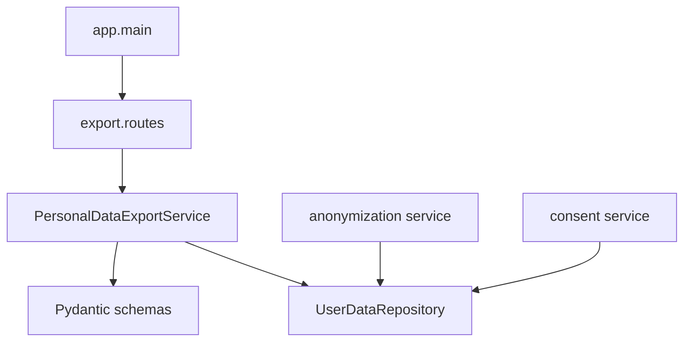

# Legacy-компонент export: міні-реверс-інжиніринг

## Вибір та довіра

**verified:** аудит ЛР10, F019, F020, F021, F022, F023,
показує для app/export/* ratio=2.0 та один code commit після останнього doc update.
Це найвищий ненульовий ratio серед app/*. Вибрано весь компонент export, а не shipping,
у якого ratio=1.06. Метрика ratio не доводить якість тексту: це критерій пріоритету рев'ю.
Точний extract та рядки коду — Lab12/evidence/legacy-analysis.json.

## Граф залежностей — verified аналізом import та викликів

**verified:** routes містить два GET aliases; service виконує перевірку actor/subject,
агрегує профіль, settings, activity, orders, consents та збирає response model.
**verified:** repository — singleton з in-memory dict/list; persistence адаптера немає.
**verified:** внутрішні password_hash/salt/token поля присутні в сирих записах;
service повертає їх allowlist-модель, а не сирий dict.

## Дані та методи

| Артефакт | Схема/призначення | Довіра |
| --- | --- | --- |
| _users | dict user_id → profile плюс внутрішні security fields | verified |
| _settings | dict user_id → locale/theme/notification preferences | verified |
| _activity / _orders / _consents | списки записів із user_id | verified |
| get_user_by_id | знаходить профіль або None | verified |
| get_*_by_user_id | вибірки пов'язаних категорій | verified |
| get_default_repository / reset_default_repository | singleton / ізольований reset | verified |
| export_user_data | authorization → lookup → allowlist → response → safe audit | verified |
| _resolve_authenticated_principal | demo actor headers/Bearer convention | verified |
| Зовнішня БД та її відмова | наразі відсутня, майбутня модель adapter outage | assumed |
| Надійна продуктивна автентифікація | demo заголовки не є доказом перевірки токена | assumed |

## Реєстр боргу

| ID | Тип | Наслідок | Пріоритет |
| --- | --- | --- | --- |
| TD-01 | architecture | RAM втрачається після restart, RPO користувацьких змін не гарантується | P1 |
| TD-02 | code | Відсутній явний unavailable boundary -> неконтрольована 500 | P1 |
| TD-03 | test | Потрібний regression storage failure для обох aliases і recovery | P1 |
| TD-04 | documentation | Немає опису storage outage та runbook | P2 |
| TD-05 | architecture | Demo identity headers непридатні як production trust boundary | P1 |

Кожен висновок про поведінку опирається на код/тест; продакшн характеристики не виміряні.
